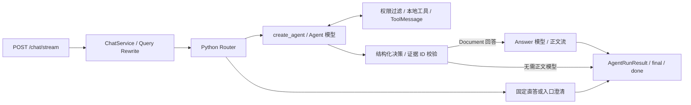

# Agentic RAG 知识库问答系统

面向中文制度、校务和规范类文档的知识库问答系统。后端使用 FastAPI，前端使用 Vue 3 + TypeScript；通过混合检索、Agent 多轮工具调用和证据校验生成带引用的流式回答，支持知识入库管理与统一评测。

## 核心能力

- **文档解析与结构保留**：支持 TXT、Markdown、PDF、DOCX；PDF/DOCX 使用 Docling，保留标题层级、正文、表格及可用页码。Markdown 和结构化文档的 chunk 保留标题路径，表格按完整行分组。
- **混合检索与重排**：jieba + BM25 关键词召回、SentenceTransformer 向量召回和 CrossEncoder 重排；Chroma 持久化文本、metadata 和 embedding，LangChain Indexing API 管理增量索引。
- **多轮 Agent**：LangChain `create_agent` 管理唯一的模型—工具循环，Agent 根据检索结果调整 query、选择文档或补读相邻 chunk。
- **证据约束的流式回答**：Agent 声明回答决策和证据 ID，校验通过后由独立 Answer 模型流式生成正文，引用由代码从选中证据投影。
- **会话与可观测性**：SQLite 保存会话历史，支持短追问改写；SSE 展示进度、工具状态和答案增量，提供 trace、metrics、工具审计和失败日志。
- **知识入库管理**：本地目录显式同步；上传文件、GitHub 文件和 Firecrawl 页面经过提案、审批、写入流程，也支持按来源撤库。
- **可选联网与评测**：按权限开放公开网页搜索、网页正文和 PDF 页范围读取；Agent/RAG 评测复用生产聊天链路，可选真实 Online case 和 LLM Judge。

## 快速启动

以下命令从仓库根目录执行。使用 **Python 3.12**，与 Docker 和后端 CI 保持一致；前端需要 **Node.js 22.12+**。

### 1. 安装后端依赖

```bash
python -m venv .venv
source .venv/bin/activate
python -m pip install -r requirements.lock
cp .env.example .env
```

Windows PowerShell 使用 `.\.venv\Scripts\Activate.ps1` 激活环境，并用 `Copy-Item .env.example .env` 复制模板。已有 `.env` 时直接编辑，保留自己的配置。

[`requirements.txt`](requirements.txt) 声明顶层依赖，[`requirements.lock`](requirements.lock) 固定安装版本，Docker 和 CI 均使用锁文件。

### 2. 配置模型并准备本地缓存

编辑 `.env`，至少替换回答模型的密钥、名称和接口地址。模板使用以下配置：

```env
LLM_API_KEY=replace-with-local-key
MODEL_NAME=deepseek-chat
LLM_API_URL=https://api.deepseek.com/v1/chat/completions
```

Agent 专用配置留空时逐项继承回答模型配置。同一模型同时承担两个角色时，服务需支持工具调用、`ToolStrategy` 所需的结构化工具选择以及正文流式输出。角色独立配置见下方「配置说明」。

**Embedding 和 reranker 都以 `local_files_only=True` 加载，启动或建索引不会自动下载这两类权重。** 首次使用可执行下面的显式下载命令；它读取当前 `.env` 中的模型名称和缓存目录，需要访问 Hugging Face：

```bash
python - <<'PY'
from huggingface_hub import snapshot_download
from app.config import get_settings

settings = get_settings()
for model_name in (settings.embedding_model_name, settings.rerank_model_name):
    snapshot_download(repo_id=model_name, cache_dir=str(settings.model_cache_dir))
PY
```

模板使用 `Qwen/Qwen3-Embedding-0.6B` 和 `BAAI/bge-reranker-v2-m3`，缓存目录为 `./.cache/huggingface/hub`。也可以配置已准备好的本地模型目录。运行时根据 PyTorch 的 CUDA 可用性选择 GPU 或 CPU。

PDF 解析还需要 Docling 的解析模型，首次解析可能下载这些资源；离线环境应提前准备。项目关闭 OCR，扫描件无法通过 OCR 补出正文。

### 3. 同步知识库并启动 API

将 `.txt`、`.md`、`.pdf`、`.docx` 文档放入模板指定的 `data/kb/`，然后执行：

```bash
mkdir -p data/kb
python -m app.rebuild_kb
uvicorn app.main:app --reload
```

启动后可访问：

- Swagger：<http://127.0.0.1:8000/docs>
- 进程健康检查：<http://127.0.0.1:8000/health>
- 知识库状态：`curl -X POST http://127.0.0.1:8000/kb_summary`

`/health` 只表示进程存活。确认知识库可检索需查看 `/kb_summary` 的 `ready`、文档数和 chunk 数。QA 启动只加载已有索引和模型缓存；修改本地文档后，再次执行同步命令并重启 QA 加载新快照。

### 4. 启动 Vue 前端

另开终端：

```bash
cd frontend
npm ci
npm run dev
```

访问 <http://localhost:5173>。页面包括智能问答、检索调试、知识库、知识入库和系统诊断，使用 hash 路由，例如 `/#/ingestion`。

浏览器使用同源相对 API 路径，Vite 默认代理到 `http://127.0.0.1:8000`。需要修改时，复制 [`frontend/.env.example`](frontend/.env.example) 为 `frontend/.env`，设置 `VITE_DEV_PROXY_TARGET` 并重启 Vite。

聊天 session ID 保存在 `sessionStorage`，页面聊天记录保留在内存；「新建对话」生成新 ID。后端会话历史持久化到 SQLite。中断生成不会自动重发请求。

## 当前架构与回答流程



图中 Answer 模型阶段适用于选中了有效 Document 的回答，具体流程如下：

1. **准备问题**：带 `session_id` 时读取最近 6 条 user/assistant 消息；短追问和指代问题可先改写为独立问题。
2. **路由与工具选择**：普通 Python Router 对固定能力问答和明确澄清做短路，其余请求进入 `create_agent`。模型只看到当前 `tool_mode` 和主体权限允许的工具。
3. **检索与观察**：工具通过 `StructuredTool → execute_project_tool → handler` 执行，结果经 `ToolMessage` 回到 Agent；Agent 可继续检索、限定文档或补读上下文。
4. **确定证据**：`ToolStrategy(FinalAgentResponse)` 校验 `answer`、`no_evidence` 或 `clarify` 决策。正文证据从本轮成功工具消息的 artifact 中恢复；未知证据 ID、无效 Document 或应引用却漏引用会导致安全失败。
5. **生成正文**：有选中证据的 `answer` 调用 `get_answer_model().astream()`，只传入问题和选中的证据。正文模型不绑定工具，输出实际文本 chunk 对应的 `answer_delta`。
6. **返回结果**：引用由代码从选中 Document 映射，`final` 返回完整业务结果。无 Document 的操作结果及 `no_evidence` 仍可一次性交付文本，澄清和错误可能没有答案增量。

Agent 循环和正文生成共用总超时预算，正文调用也占用模型调用名额。框架与项目 Middleware 同时约束模型/工具调用次数、工具错误、重复调用和连续相同错误。

检索工具只提供证据，知识入库由独立写侧处理。MCP 只服务 GitHub / Firecrawl 入库来源，不进入问答 Agent。架构边界见[当前系统架构](docs/architecture/current-system.md)，SSE 的详细行为见[聊天流式 API](docs/api/chat-streaming.md)。

## 配置说明

完整模板见 [`.env.example`](.env.example)，字段解析与校验见 [`app/config.py`](app/config.py)。配置由冻结的 `AppSettings` 管理，优先级为：

```text
显式 AppSettings(...) 参数 > 进程环境变量 > 项目根目录 .env > 字段默认值
```

相对路径按项目根目录解析。下面提到的示例值以 `.env.example` 为准；模板覆盖了部分代码默认值。修改 `.env` 后需重启服务，配置不会热更新。

### 模型角色

| 角色 | 配置 | 当前用途与回退 |
| --- | --- | --- |
| Answer / Composer | `LLM_API_KEY`、`MODEL_NAME`、`LLM_API_URL`、`TEMPERATURE`、`LLM_MAX_TOKENS`、`LLM_TIMEOUT`、`LLM_MAX_RETRIES` | 根据已校验证据生成正文；基础密钥仍兼容 `DEEPSEEK_API_KEY` |
| Agent | `AGENT_LLM_API_KEY`、`AGENT_MODEL_NAME`、`AGENT_LLM_API_URL`、`AGENT_TEMPERATURE`、`AGENT_LLM_MAX_TOKENS`、`AGENT_LLM_TIMEOUT`、`AGENT_LLM_MAX_RETRIES` | 负责工具调用与结构化决策；未配置字段逐项继承 Answer |
| Query Rewrite | `ENABLE_QUERY_REWRITE`、`QUERY_REWRITE_API_KEY`、`QUERY_REWRITE_MODEL_NAME`、`QUERY_REWRITE_API_URL`、`QUERY_REWRITE_TIMEOUT`、`QUERY_REWRITE_MAX_TOKENS`、`QUERY_REWRITE_TEMPERATURE` | 多轮追问改写；模板独立指定 `deepseek-chat`，默认超时 10 秒、无模型重试 |
| Evaluation Judge | `USE_LLM_JUDGE`、`JUDGE_API_KEY`、`JUDGE_MODEL`、`JUDGE_API_URL`、`JUDGE_TIMEOUT`、`JUDGE_MAX_RETRIES`、`JUDGE_MAX_TOKENS` | 可选离线评测判分；正式 Runner 通过 `--use-llm-judge` 显式开启 |

`AGENT_ENABLE_THINKING` 是 Agent 专用开关，留空表示不发送该参数。使用模板注释所述的 Qwen 配置时应设为 `false`，避免思考模式与当前 `ToolStrategy` 的 `tool_choice=required` 冲突。

Query Rewrite 使用独立的 `QUERY_REWRITE_TIMEOUT`，调整 `LLM_TIMEOUT` 不会改变它。改写模型不可用或调用失败时，已有规则回退仍可继续主链路。切换到其他提供方或本地服务时，也应同步检查模板中显式设置的 Query Rewrite 和 Judge 地址。

### 索引、权限与运行预算

| 配置 | 说明 |
| --- | --- |
| `RAG_FILE_PATH` | 本地知识目录，模板为 `./data/kb` |
| `INDEX_STORE_DIR` | manifest 与 RecordManager 存储目录，模板为 `./data/manifest` |
| `CHROMA_PERSIST_DIR` / `CHROMA_INDEX_COLLECTION_NAME` | 当前持久化索引目录 / collection，模板为 `./data/chroma` / `mini_rag_chunks_v2` |
| `CHUNK_SIZE` / `CHUNK_OVERLAP` | 切分参数，模板为 600 / 120；结构化表格保留完整行，单行可超过目标长度 |
| `EMBEDDING_MODEL_NAME` / `RERANK_MODEL_NAME` | 向量与重排模型名称或本地路径 |
| `MODEL_CACHE_DIR` | 模型缓存目录；未指定时继续按 `HF_HUB_CACHE`、`HF_HOME/hub`、`SENTENCE_TRANSFORMERS_HOME` 和项目默认目录解析 |
| `TOP_K` / `VECTOR_THRESHOLD` | 诊断搜索默认条数 / 分数门；不控制 Agent 每轮的检索参数或最终证据决策 |
| `TOOL_DEFAULT_PERMISSIONS` | 默认 `knowledge_base:read`；Web 权限需显式添加 |
| `AGENT_MAX_ITERATIONS` / `AGENT_MAX_TOOL_CALLS` | 默认最多 6 次模型调用、10 次工具调用；正文生成需要剩余模型调用名额 |
| `AGENT_MAX_TOOL_ERRORS` | 累计工具错误上限，默认 3 |
| `AGENT_MAX_CONSECUTIVE_SAME_TOOL_CALLS` / `AGENT_MAX_CONSECUTIVE_SAME_TOOL_ERRORS` | 连续相同调用 / 错误阈值，默认均为 2 |
| `AGENT_MAX_TOTAL_COST_MS` | Agent 循环、证据校验和正文流的共同预算，默认 120000 毫秒 |
| `SQLITE_DB_PATH` | 会话、入库候选和索引操作历史，模板为 `./data/app.sqlite` |

### 可用工具与 Web 权限

当前 catalog 有七个生产工具，实际可见集合还受请求的 `tool_mode` 限制：

| 工具 | 用途 | 所需权限 |
| --- | --- | --- |
| `search_knowledge_base` | 全库混合检索与重排，返回 Document 证据 | `knowledge_base:read` |
| `find_documents` | 列出或查找文档，返回目录信息 | `knowledge_base:read` |
| `search_document` | 在指定文档内检索正文 | `knowledge_base:read` |
| `get_chunk_context` | 读取已知 chunk 的原文或同文档相邻 chunk | `knowledge_base:read` |
| `web_search` | 使用 DDGS 搜索标题、URL 和摘要 | `web:search` |
| `web_fetch` | 提取公开 HTML、XHTML 或纯文本网页正文 | `web:fetch` |
| `web_pdf_fetch` | 使用 pypdf 提取公开 PDF 的指定连续页范围 | `web:fetch` |

默认 Web 工具不可见。要支持搜索后读取正文，在后端 `.env` 设置并重启：

```env
TOOL_DEFAULT_PERMISSIONS=knowledge_base:read,web:search,web:fetch
```

`rag_only` 请求仍只允许四个知识库工具；`full` 也不会绕过权限。`find_documents` 的目录信息和 `web_search` 的摘要不属于正文 Document 证据，回答正文问题时应继续读取实际内容。`get_chunk_context` 接受 metadata 中的 `chunk_id`，不是 Document 的 evidence ID。

Web 正文下载共用 `requests-hardened` 的网络校验和有限 streaming 读取；网页由 Trafilatura 提取，PDF 由 pypdf 提取。网页/PDF 内容视为不可信数据，不自动写入知识库。搜索查询会发送到外部搜索服务。

`web_fetch` 不支持 PDF 或 JavaScript 渲染；`web_pdf_fetch` 不支持 OCR。超时、体积上限、重定向和代理配置见 `.env.example`。`WEB_TRUSTED_PROXY_MODE` 默认关闭；显式开启会把 DNS/IP 与重定向目标策略委托给受信代理，适用边界见 [Web Fetch ADR](docs/adr/0009-secure-web-fetch-tool.md) 和 [Web PDF ADR](docs/adr/0010-secure-web-pdf-fetch-tool.md)。

## 知识入库与索引维护

### 本地目录同步

```bash
python -m app.rebuild_kb
```

普通文件变化走增量同步。切分参数、embedding 模型、索引版本、namespace 或 collection 变化会要求重建；当前 `pipeline_version` 为 **6**，以 [`app/indexing/manifest.py`](app/indexing/manifest.py) 为准。Reranker、Prompt 和回答模型变更不要求重建向量索引。

确需全量重建时：

```bash
python -m app.rebuild_kb --force-rebuild
```

全量重建会重新解析本地文件，并从 SQLite 恢复外部来源最新成功 INDEX 对应的候选，排除最新成功操作为 REMOVE 的来源；不会重新抓取外部页面，也不会把仅审批、未成功入库的候选写入索引。独立 CLI 完成后需重启 QA。

### 上传、GitHub 与 Firecrawl

在后端启用管理 API 并配置独立密钥，然后重启服务：

```env
INGESTION_ADMIN_API_ENABLED=true
INGESTION_ADMIN_API_KEY=replace-with-admin-key
```

在 Vue 的「知识入库」页输入该密钥，仅保存在浏览器内存，刷新后清除。API 使用 `X-Ingestion-Admin-Key`；不要把密钥放入 `VITE_*` 或 URL。

```text
上传文件 / GitHub 文件 / Firecrawl 页面
→ 来源提案 → pending candidate → 显式审批 → 单独写入知识库
→ Chroma / RecordManager / 索引操作历史 → 刷新当前应用的查询索引
```

上传支持单个 PDF、DOCX、TXT、MD，`INGESTION_UPLOAD_MAX_BYTES` 默认 20 MiB。上传原文件解析后删除，候选保存正文与可用结构。批准和写入是两个独立操作；这些候选来自管理端提案，问答 Agent 不负责生成或审批。

GitHub / Firecrawl 还需启用 `MCP_TOOLS_ENABLED=true`，将 [`config/mcp_servers.example.json`](config/mcp_servers.example.json) 复制为 Git 忽略的 `config/mcp_servers.local.json`，配置来源端点、凭据与精确只读 allowlist。HTTP 应用仅在启用入库管理 API 时初始化 MCP；本地上传不需要 MCP。

结构化 PDF/DOCX 和 Firecrawl cleaned HTML 复用 Docling 解析及表格切分，保留标题路径。历史候选若只保存了纯文本，重建无法恢复已丢失的结构，需要重新上传或抓取、审批并写入。

上传、GitHub、Firecrawl 来源可在候选详情中「移出知识库」，撤除该来源的全部现有 chunk，并保留候选和操作历史。组合应用在成功 INDEX/REMOVE 后尝试刷新当前进程索引；刷新失败时需重启 QA。独立 QA 进程仍需自行重新加载。

详见[入库运营 API](docs/ingestion/operations-api.md)、[MCP 来源配置](docs/tools/mcp-client.md)、[增量索引](docs/ingestion/langchain-indexing.md)和[结构化解析与切分](docs/ingestion/structured-documents.md)。

## API 与流式响应

| 方法 | 接口 | 用途 |
| --- | --- | --- |
| GET | `/health` | 轻量进程存活检查 |
| POST | `/chat/stream` | 唯一聊天入口，SSE 响应 |
| POST | `/search` | 诊断检索和重排，不调用聊天模型 |
| POST | `/decide` | 查看确定性 Router 决策，不执行 Agent 或工具 |
| POST | `/kb_summary` | 当前知识库 ready 状态、文档数、chunk 数和索引来源 |
| GET | `/docs-preview` | 已加载文档列表 |
| GET | `/chunks-preview` | chunk 预览，支持 `max_len`、`limit`、`file_name` |
| GET | `/metrics-summary` | 最近请求指标，`limit` 默认 20，范围 1–200 |
| 多种 | `/admin/ingestion/*` | 可选入库管理 API，默认不注册，启用后需管理密钥 |

### 聊天

```bash
curl --no-buffer -X POST http://127.0.0.1:8000/chat/stream \
  -H 'Content-Type: application/json' \
  -H 'Accept: text/event-stream' \
  -d '{"question":"缓考应该如何办理？","session_id":"demo-001","tool_mode":"rag_only"}'
```

请求只接受 `question`、可选 `session_id` 和 `tool_mode`（`full` / `rag_only`，默认 `full`）。不传 session 时按单轮处理。`top_k` 等未知字段返回 HTTP 422；检索条数由 Agent 在工具调用中选择。

正常 SSE 顺序为：

```text
start → progress / tool / answer_delta ... → final → done
```

- `answer_delta.data.text` 为可展示的答案增量；有证据的正文来自 Answer 模型实际文本 chunk，chunk 不保证逐 token 对齐。
- `final.data.response` 是权威 `ChatResponse`，包含答案、引用、业务状态及 `tool_trace`；客户端应据此覆盖临时文本。已收到部分答案不代表请求成功。
- Schema 校验通过后建流返回 HTTP 200，业务错误在 `final.data.http_status`、`final.data.response.code` 和结果状态中表达；空问题同样建流，但 final 表示 `EMPTY_QUESTION` / 400。
- `retrieval_confidence` 和 `answer_confidence` 当前固定为 `0.0`，不是质量评分。`router_llm_used` 固定为 `false`。
- `X-Trace-Id` 可由请求传入，响应头与 SSE 信封均提供 trace ID；完整耗时位于 `final.data.total_cost_ms`。客户端断开后不再发送 final/done，也不保存部分 assistant 文本。

完整字段、异常和取消语义见[聊天流式 API](docs/api/chat-streaming.md)。

### 检索调试

```bash
curl -X POST http://127.0.0.1:8000/search \
  -H 'Content-Type: application/json' \
  -d '{"question":"普通本科四年制专业最长学习年限是多少？","top_k":5}'
```

`top_k` 范围为 1–10，省略时使用 `TOP_K`。结果包含来源、chunk ID、片段，以及 BM25、向量、混合和 rerank 分数。该接口的诊断分数门独立于 Agent 的证据选择。

## 日志、检查与评测

默认日志位置可通过 `.env` 调整：

| 文件 | 内容 |
| --- | --- |
| `logs/metrics.jsonl` | 聊天状态、阶段耗时、模型调用及流事件统计 |
| `logs/tool_audit.jsonl` | 按工具审计策略脱敏、裁剪后的调用记录 |
| `logs/bad_cases.jsonl` | 模型、工具、引用和运行异常等失败样例 |

### 开发检查

后端 CI 执行以下检查；完整 pytest 中包含 PDF 解析测试，CI 会预先准备 Docling 解析模型，再以离线模式运行：

```bash
python -m compileall -q app scripts tests
ruff check app tests scripts
lint-imports
python scripts/inspect_agent_runtime.py --check
python scripts/run_evaluation_baseline.py --validate-only
python -m pytest -q
```

Runtime inspection 也支持 `--format json` 和 `--format mermaid`，只检查图与合同，不调用模型或工具。Import Linter 单独验证模块依赖；职责与排查入口见 [Runtime 维护指南](docs/agent-runtime-maintenance.md)。

前端检查在 `frontend/` 中运行：

```bash
npm run typecheck
npm run test -- --run
npm run build
```

`npm run preview` 在 <http://localhost:4173> 预览构建结果，并沿用 Vite API 代理。构建出的 `dist/` 需要另行静态托管和配置 API 反向代理；当前 Docker 镜像只启动后端。

### 统一评测

正式入口为 `scripts/run_evaluation_baseline.py`，默认数据包含 25 个 Core Agent case、3 个可选 Online case 和 65 道 RAG 题。`--validate-only` 只校验数据合同，不加载模型或索引。

真实运行需要可用模型、索引、本地权重、干净工作区和新的输出目录：

```bash
python scripts/run_evaluation_baseline.py \
  --output-dir outputs/evaluation_baseline_v2/core-run \
  --retrieval-k 5
```

默认运行 Core Agent + RAG；`--agent-only` / `--rag-only` 限定题集，`--include-online` 开启真实 Web case。语义 Judge 需显式开启，例如：

```bash
python scripts/run_evaluation_baseline.py \
  --rag-only --use-llm-judge --judge-model deepseek-chat \
  --output-dir outputs/evaluation_baseline_v2/rag-judge
```

当前使用 **Prediction Schema v3**：RAG 经生产 `ChatService.stream → stream_agent → create_agent` 链路，每题使用空 session 和 `rag_only`。`retrieved_chunk_ids` 记录有序去重的 KB 观察，`reference_chunk_ids` 记录最终通过校验的引用。`--retrieval-k` 仅控制评分 cutoff，不传入 Agent 工具。

主要指标为 prediction coverage、retrieval Gold Recall@K、reference Gold Recall，以及可选的 Answer Correctness。Judge 关闭或失败时正确性分数为 `None`，判分覆盖率单独报告。历史旧工作流分数不能直接作为当前实现成绩。

唯一机器可读汇总为 `baseline_summary.json`，运行还保存 manifest、逐题结果、失败记录和 Markdown 报告。比较已有运行：

```bash
python scripts/compare_evaluation_runs.py \
  --baseline outputs/evaluation_baseline_v2/run-a \
  --candidate outputs/evaluation_baseline_v2/run-b
```

正式运行默认拒绝 dirty 工作区；`--allow-dirty` 仅用于带标记的实验。比较先校验 manifest 的可比性，Online 结果需单独解释。完整合同见 [Evaluation Baseline](docs/evaluation/baseline-v2.md)和[评测启动说明](scripts/evaluation/README.md)。

## Docker

[`docker-compose.yml`](docker-compose.yml) 当前包含 NVIDIA GPU 设备预留，运行需要相应驱动与 NVIDIA Container Toolkit；CPU 环境需先移除该设备预留。镜像使用 Python 3.12 和 `requirements.lock`。

准备 `.env` 后，先构建镜像。Compose 的模型缓存位于独立命名卷 `model-cache`，宿主机 `.cache/` 不会自动映射进去，可在容器中显式下载：

```bash
docker compose build
docker compose run --rm -T rag-api python - <<'PY'
from huggingface_hub import snapshot_download
from app.config import get_settings

settings = get_settings()
for model_name in (settings.embedding_model_name, settings.rerank_model_name):
    snapshot_download(repo_id=model_name, cache_dir=str(settings.model_cache_dir))
PY
```

现有 Compose 挂载了知识目录、Chroma、manifest、日志和模型缓存，**未挂载默认的 `data/app.sqlite`**。需要保存会话和外部入库历史时，应在首次运行前为服务补充 SQLite 目录挂载，例如在本地 `docker-compose.override.yml` 中配置：

```yaml
services:
  rag-api:
    environment:
      SQLITE_DB_PATH: /app/data/runtime/app.sqlite
    volumes:
      - ./data/runtime:/app/data/runtime
```

已有 SQLite 数据时应先迁移到该目录；索引同步容器与 API 容器需使用相同的持久化配置。随后同步并启动：

```bash
docker compose run --rm rag-api python -m app.rebuild_kb
docker compose up -d
docker compose logs -f rag-api
```

容器中的本地模型服务地址需使用可达的宿主机或服务名；例如宿主机 Ollama 通常通过 `host.docker.internal:11434` 访问。修改本地知识后先同步，再用 `docker compose restart rag-api` 加载索引。更多运维命令见 [DEPLOY.md](DEPLOY.md)。

## 目录与文档导航

```text
app/
├── api/             # FastAPI 路由、生命周期和 SSE 适配
├── services/        # 聊天、会话、状态与 telemetry 编排
├── agent/           # Router、create_agent、治理、证据校验和正文流
├── tools/           # 本地工具、输出合同、执行治理及入库 MCP client
├── ingestion/       # 文档解析、结构、候选与审批合同
├── sources/         # Upload / GitHub / Firecrawl 来源适配
├── indexing/        # 切分、LangChain 增量索引与 manifest
├── rag/             # 索引读取、混合检索、重排与诊断
├── llm/             # 按角色配置的模型工厂与结构化调用网关
├── storage/         # SQLite 与 Chroma 存储边界
├── contracts/       # 聊天状态和工具模式合同
├── observability/   # metrics 与失败日志
├── config.py        # AppSettings
└── rebuild_kb.py    # 显式索引同步 CLI
frontend/            # Vue 3 + TypeScript 界面与测试
scripts/             # Runtime 检查、统一评测和来源 smoke
tests/               # 后端单元、合同与集成测试
data/eval/           # 版本化评测数据
docs/                # 架构、API、入库、评测与历史决策
```

| 主题 | 文档 |
| --- | --- |
| 系统职责与依赖边界 | [当前系统架构](docs/architecture/current-system.md)、[模块边界](docs/architecture/module-boundaries.md) |
| Runtime 维护与工具声明 | [维护指南](docs/agent-runtime-maintenance.md)、[原生工具声明](docs/tools/native-tool-declaration.md) |
| SSE 事件与取消语义 | [聊天流式 API](docs/api/chat-streaming.md) |
| 知识运营与来源接入 | [运营 API](docs/ingestion/operations-api.md)、[MCP 来源](docs/tools/mcp-client.md)、[入库合同](docs/ingestion/knowledge-ingestion-contract.md) |
| 结构化解析与索引 | [结构化文档](docs/ingestion/structured-documents.md)、[增量索引](docs/ingestion/langchain-indexing.md) |
| 评测与数据 | [Baseline 合同](docs/evaluation/baseline-v2.md)、[评测数据](data/eval/README.md) |
| 历史设计决策 | [ADR](docs/adr/)、[Agent 演进归档](docs/history/agent-evolution-2026.md) |

## 已知边界

- 当前不支持 OCR、旧版 `.doc`、图片知识入库或网页 JavaScript 渲染；复杂表格与标题识别受解析器输出限制。
- 证据校验保证引用来自本轮有效工具结果，不能替代对模型正文事实正确性的评测；两个 confidence 字段目前只保留兼容值。
- SQLite、本地 Chroma 和进程内索引快照适合当前单实例部署，多实例需另行规划存储、写入并发和索引刷新。
- 当前没有 Interrupt/Resume、多 Agent 或 SQL 写工具；MCP client 仅开放受治理的入库来源调用。
- Embedding、reranker 和 PDF 解析模型需要预先准备相应资源；联网工具及真实模型评测受服务可用性、费用与外部内容变化影响。
