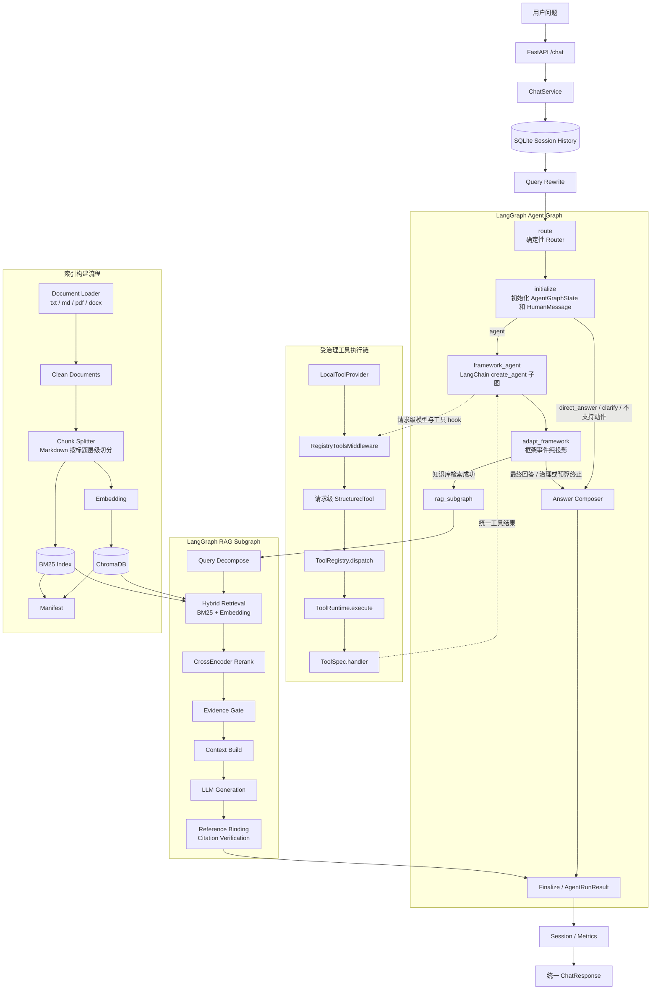

# Agentic RAG 知识库问答系统

一个面向中文制度类文档的 Agentic RAG 问答系统，支持文档解析、混合检索、重排、引用生成、Agent 路由、多轮追问改写、可观测性和离线评测。

本项目基于 FastAPI 构建，围绕中文知识库问答场景实现了一条完整的 RAG 工程链路：读取本地 `.txt` / `.md` / `.pdf` / `.docx` 文档，按文档结构切分 chunk，构建 BM25 + SentenceTransformer Embedding 混合检索索引，使用 CrossEncoder reranker 重排候选证据，再通过 OpenAI-compatible Chat Completions 模型生成带引用的答案。`/chat` 唯一使用 LangGraph 父图中的 LangChain `create_agent` 执行模型—工具循环；传入 `session_id` 时还会结合 SQLite 中最近的会话历史对短追问做 Query Rewrite。

## 项目亮点

- 中文知识库问答：面向中文制度、校务、规范类文档，支持本地文档解析、检索、回答和引用溯源。
- 混合检索：BM25 负责关键词精确匹配，SentenceTransformer Embedding 负责语义召回，提升中文问答召回稳定性。
- CrossEncoder rerank：对候选 chunk 做二阶段重排，缓解初召回排序不准的问题。
- ChromaDB 持久化：chunk 文本、metadata 和 embedding 持久化保存，服务重启可复用索引缓存。
- 图内确定性入口 Router：由 LangGraph 父图在每次 Runtime 调用时执行一次，只处理空问题、少量稳定直答和明确澄清；其他自然语言请求统一进入 `agent`，具体工具由 Agent Model 根据当前请求可见的动态 Tool Schema 选择。
- 框架原生 Agent Runtime：LangGraph 父图嵌入 LangChain `create_agent` 子图，由框架管理模型—工具循环、参数校验、ToolMessage 和调用上限。
- 权限感知的 Registry-driven 工具发现：Provider 按请求权限只暴露满足 `required_permissions` 的工具，Middleware 将其注入模型和执行层；工具仍经 `StructuredTool → ToolRegistry → ToolRuntime` 执行。
- Agent 循环防护：工具错误总数、连续相同调用、连续相同错误和模型/工具累计耗时均有独立预算；终止错误对同批后续调用 fail-closed，并补齐关联 ToolMessage。
- 多轮追问改写：同一 `session_id` 下通过 SQLite 保留最近会话历史，短追问和指代问题会先改写成独立检索问题。
- 工具调用：支持知识库检索、公开网页搜索与受治理的单页正文提取、双文档内容对比、简单四则运算、列出知识库文档和查看指定 chunk 原文。
- 引用绑定和拒答机制：模型输出的 `Reference N` 会绑定回真实文件与 chunk；证据不足或引用支撑不足时拒答。
- 可观测性：每次 `/chat` 请求记录 `trace_id`、阶段耗时、状态、工具调用、引用数量和 LLM 调用次数。
- bad case 日志：对模型格式异常、引用异常、工具异常、索引未就绪等失败样例做结构化记录。
- 离线评测闭环：支持批量生成预测结果，并从答案质量、检索命中、行为约束和可选 LLM Judge 语义判断等维度评测。

## 系统架构



## 核心能力

| 模块 | 已实现能力 |
| --- | --- |
| 文档读取 | 支持 `.txt`、`.md`、`.pdf`、`.docx`；文本类文件自动识别编码，PDF/DOCX 提取可检索文本 |
| 文档切分 | 普通文本按段落和标点递归切分；Markdown 按标题层级切分并保留标题路径 |
| 混合检索 | jieba + BM25 关键词召回，SentenceTransformer Embedding 语义召回 |
| 重排 | CrossEncoder reranker 对候选 chunk 重新排序 |
| 问题拆分 | 可选 Query Decompose，复杂问题可拆成子问题后多路召回并合并证据 |
| 多轮追问 | `session_id` 通过 SQLite 维持最近会话历史，对短追问、指代问题做 Query Rewrite |
| 答案生成 | 调用 OpenAI-compatible Chat Completions，要求模型返回 JSON |
| 引用绑定 | 将 `Reference N` 映射回真实文件、`chunk_id`、`snippet` 和分数 |
| Agent Runtime | LangGraph 父图嵌入唯一的 LangChain `create_agent` 子图；框架负责模型—工具循环、参数校验、ToolMessage 和模型/工具调用上限 |
| Agent 路由 | 父图 `route` 是唯一 Router 所有者；所有 Runtime 调用先路由再 initialize。正常请求输出 `agent`，`direct_answer` / `clarify` 在 initialize + compose 中安全短路 |
| 工具发现 | `ToolProvider` 按请求权限过滤模型可见 ToolSpec，`RegistryToolsMiddleware` 对模型绑定和实际执行使用同一组请求级 StructuredTool；普通新工具无需修改核心编排 |
| Agent Guardrail | 工具错误总数、连续相同调用/错误、累计模型与工具耗时预算、同批 fail-closed、无悬空 ToolMessage |
| 工具调用 | Registry 注册八个生产工具：`search_knowledge_base`、`web_search`、`web_fetch`、`web_pdf_fetch`、`compare_documents`、`simple_calculator`、`list_documents`、`get_chunk_text`；默认可见数量由请求权限决定 |
| 可观测性 | `trace_id`、请求耗时、阶段耗时、工具调用日志、metrics 汇总接口 |
| 失败分析 | `logs/bad_cases.jsonl` 记录值得分析的失败样例 |
| 评测 | 支持规则评测、Chroma/chunks 索引取证和可选 LLM Judge 语义评估 |
| 索引缓存 | ChromaDB 持久化 chunk、metadata、embedding，manifest 记录索引构建状态 |

## RAG 流程说明

1. 文档加载：从 `RAG_FILE_PATH` 读取 `.txt` / `.md` / `.pdf` / `.docx` 文档。
2. 文本清洗：统一清理不可见字符、空白和文档噪声。
3. 文档切分：Markdown 先按标题层级切分并保留标题路径，普通文本按段落和标点递归切分。
4. 建立索引：构建 BM25 关键词索引，并使用 SentenceTransformer 生成 embedding；向量、chunk 和 metadata 持久化到 ChromaDB。
5. 多轮改写：`/chat` 如果传入 `session_id`，会读取最近历史；短追问或指代问题会先改写成独立问题。
6. Agent 执行：ChatService 把改写后的问题直接交给 LangGraph Runtime；父图入口 `route` 执行一次粗粒度 Router，再进入 initialize。普通问题由 Agent Model 根据 Provider 动态提供的工具描述、参数 Schema、AIMessage 与 ToolMessage 迭代选择工具或生成最终回答。`direct_answer` 和 `clarify` 不调用 Agent Model；外部旧 decision 会被图内 Router 覆盖。Agent 选择知识库检索后仍统一进入专用 RAG 子图。
7. 查询拆分：启用 `ENABLE_QUERY_DECOMPOSE` 后，复杂问题可由拆分模型生成子问题。
8. 混合召回：查询时同时执行 BM25 和 embedding 召回，合并候选 chunk。
9. 二阶段重排：使用 CrossEncoder reranker 对候选证据重新排序。
10. 构造上下文：按 `MAX_CONTEXT_CHARS` 控制上下文长度，组装带 `Reference N` 的 evidence context。
11. LLM 生成：调用 OpenAI-compatible Chat Completions，要求返回结构化 JSON。
12. 引用绑定：解析模型返回的 references，并绑定到真实文件、chunk、snippet、score。
13. 置信度与拒答：结合召回分数、引用数量和证据阈值估算置信度；证据不足、检索为空或引用支撑不足时返回拒答状态。

## 评测结果

| Metric              |  Score |
| ------------------- | -----: |
| Evaluation Cases    |     65 |
| Final Score         | 0.9605 |
| Key Point Recall    | 0.9353 |
| Gold Chunk Hit@K    | 0.9846 |
| Gold Chunk Recall@K | 0.9756 |
| Gold Document Hit@K | 0.9846 |
| Behavior Score      | 0.9846 |
| Forbidden Hit       |      0 |

评测集覆盖 `single_doc`、`cross_doc`、`partial_answer`、`not_in_doc`、`trap` 五类问题。系统在普通单文档问答、跨文档问答和无答案拒答场景中表现稳定；当前主要优化方向是 `partial_answer` 场景和新旧政策冲突类 `trap` 问题。

## 工程化设计

- 配置通过 `.env` 管理，`.env.example` 提供默认模板，回答/Agent 模型、追问改写模型、拆分模型和评测 Judge 均使用 OpenAI-compatible Chat Completions 配置。
- 应用内部模型调用统一由 LangChain `ChatOpenAI(base_url=...)` 访问 OpenAI-compatible 服务，各角色原有模型环境变量仍然有效。
- `requirements.txt` 保留顶层依赖声明，`requirements.lock` 固定 Python 3.12 验证过的版本；Docker 和 CI 均使用 lock 文件安装依赖。
- 支持 embedding / rerank 模型本地缓存，默认缓存目录为 `./.cache/huggingface/hub`，也可通过 `MODEL_CACHE_DIR`、`HF_HOME` 等环境变量调整。
- 支持 ChromaDB 持久化，默认将向量、chunk 文本、metadata 和文档注册信息保存到 `data/chroma/`。
- 启动时基于 manifest 判断是否需要重建索引；知识库文件、chunk 参数、embedding/rerank 模型或 pipeline 版本变化会触发重建。
- 多轮会话历史保存在 `SQLITE_DB_PATH` 指定的 SQLite 数据库中，每个 `session_id` 默认读取最近 6 条 user/assistant 消息，服务重启后仍可继续使用。
- 设置 `ENABLE_AGENT_TRACE_STORE=true` 后，Agent 的运行摘要和步骤明细会写入同一 SQLite 数据库的 `agent_runs`、`agent_steps` 表。
- `/chat` 请求支持继承或生成 `trace_id`，响应头返回 `X-Trace-Id` 和 `X-Total-Cost-Ms`。
- metrics 记录 Query Rewrite、路由、检索、问题拆分、重排、上下文构造、LLM 调用、JSON 解析等阶段耗时和 LLM 调用次数；兼容字段 `rag_ready_check_cost_ms` 保留为 `0`。
- bad case 日志用于定位失败样例，包括模型 JSON 解析失败、引用异常、工具异常、内部异常和索引未就绪。

模型客户端统一和 LangGraph 编排彼此独立；LangGraph 主图不改变 RAG 检索、Rerank、ChromaDB 数据结构和引用机制。

## Chat 应用服务层

`/chat` 控制器现在只负责读取 HTTP 请求上下文、调用 `ChatService`、设置状态码，并使用现有 Response Builder 构造响应。Query Rewrite、Runtime 调用、metrics 和 session 存储由 `app/services/chat_service.py` 编排；Router 由 LangGraph 父图的 `route_node` 唯一持有，因此聊天业务仍可脱离 FastAPI 测试且不会形成第二个路由入口。

API 请求与响应 Schema、HTTP 状态语义和 trace 响应头保持不变；ChatService 固定调用 LangGraph 主图，知识库回答统一进入 RAG 子图。

最终结果只经过一条状态链：

```text
AgentGraphState.status
→ app/agent/results.py 的内部状态 mapper
→ AgentRunResult（Pydantic 校验后 dump 为普通 dict）
→ app/contracts/chat.py 的 ChatStatusPolicy
→ ChatServiceOutcome / HTTP、API data.status 与 metrics status
```

RAG 状态先由同一结果模块中的 RAG-to-Agent mapper 写回
`AgentGraphState.status`。`AgentRunResult` 实例不会写入 LangGraph State 或
Checkpoint；Graph 的 `result` channel 始终保存 JSON-compatible 普通字典。
HTTP code/message、公开小写状态和 metrics 状态由唯一
`CHAT_STATUS_POLICIES` 决定，API Response Builder 不再读取业务状态表，也不依赖
ChatService 实现。

## LangChain Tool 适配层

`RegistryToolsMiddleware` 在每次模型调用和工具执行时从同一 `ToolProvider` 解析稳定有序的 `ToolSpec`，再构造请求级 LangChain `StructuredTool`。`ToolRuntime` 注入参数不会出现在模型 Schema 中；适配函数从 `runtime.context` 取得 trace、session、principal、permissions、source 和 idempotency key，再调用定义所属的 `ToolRegistry.dispatch()`。Registry 继续统一进入项目 `ToolRuntime.execute()`，参数治理、权限、审批、超时、重试、审计、脱敏和错误码均未绕过。

新增普通本地工具只需创建合法 `ToolSpec` 并注册到 Registry，不需要修改 Router、父图、`create_agent` 或 Middleware。`LocalToolProvider` 复用精确、区分大小写的 `has_permission()`，仅当 Context 满足全部 `required_permissions` 时才向模型暴露工具；空权限要求始终可见。过滤保持 Registry 顺序，不执行完整 Policy、handler、Runtime 或审计，也不会因审批、风险等级或暂缺幂等键隐藏工具。

模型伪造未绑定的隐藏名称时沿用框架未知工具路径，只返回 `unknown_tool`，不证明工具是否存在，也不泄漏 description、参数 Schema 或缺失权限。模型可见性不是授权替代：所有真实调用仍进入 `ToolRegistry.dispatch() → ToolRuntime.execute()` 做最终权限与执行期治理；绕过模型可见性直接分发无权工具仍返回 `permission_denied`。多 Provider 合并保持 Provider/注册顺序并拒绝重名；当前生产环境只有 `LocalToolProvider`。

模型—工具循环由 `langchain.agents.create_agent` 构建；其内部使用 LangGraph 标准 model/tools 节点处理 Pydantic 校验、同轮调用和基础 ToolMessage。动态工具通过 Middleware 覆盖请求，而不是在父图节点中手工 `bind_tools()`。`ModelCallLimitMiddleware` 和 `ToolCallLimitMiddleware` 分别执行单次 run 的模型与工具调用上限，父图调用还设置 `recursion_limit` 作为最终图级兜底。

`ProjectToolGovernanceMiddleware` 只保留框架无法决定的项目语义：错误码分类、累计错误、连续相同调用/错误、协作式总耗时预算以及 terminal error 同批 fail-closed。已注册工具的调用指纹复用 `app.tools.policy.build_tool_args_fingerprint()`；未知模型 JSON 只做小型 JSON-compatible fallback。它不执行 handler、不复制 ToolRuntime 重试，也不自行实现参数校验或工具循环。

## Web Search

`web_search` 使用开源 `ddgs` 的公共 Python API 搜索公开互联网中的当前或外部信息，只返回有限的 `title`、`url` 和 `snippet`。它与 `search_knowledge_base` 的边界不同：后者读取本地受控知识库并进入专用 RAG 引用路径；Web Search 是普通 Agent 工具，结果形成 ToolMessage 后回到 Agent Model，不设置 `pending_rag_result`，也不进入 RAG 子图。

Web Search 默认关闭可见性。要让默认 `/chat` 服务主体看到它，必须显式配置：

```env
TOOL_DEFAULT_PERMISSIONS=knowledge_base:read,web:search
```

搜索 query 会发送到外部搜索服务，可能受搜索服务限流、地区设置和网络条件影响。搜索摘要可能不准确、过时或含恶意指令，输出始终带有 `content_is_untrusted=true`；模型不得执行摘要中的命令，使用搜索信息回答时应列出实际使用的标题和 URL。代理配置不会写入工具输出或审计。

真实网络验证只通过维护者手动运行，不进入 Pytest/CI：

```bash
python scripts/smoke_test_web_search.py \
  --query "LangGraph latest release" \
  --max-results 3
```

脚本默认经过 `ToolRegistry → ToolRuntime → DDGS` 生产链路，不调用 Agent 模型、不读取或修改知识库；缺少 `web:search` 权限时会直接给出启用提示。

## Web Fetch

`web_fetch` 用于已知具体公开 URL 后读取单个网页正文；通常由 Agent 在 `web_search` 返回候选标题、URL 和摘要后选择调用，也可读取用户明确提供的 URL。下载层固定使用 `requests-hardened==1.3.0` 做 SSRF IP 过滤和逐跳安全重定向，正文提取固定使用 `trafilatura==2.1.0`，而权限、总体超时、一次有限重试、审计和输出校验仍由现有 `ToolRuntime` 负责。`search_knowledge_base` 则只读取本地受控知识库并进入 RAG 引用路径。

模型只能提供 `url` 和 `max_chars`，不能提供 method、headers、Cookie、Authorization、proxy、timeout 或 body。应用层只接受 HTTP(S)、无 credentials、无控制字符且端口为 80/443 的 URL。默认 `WEB_TRUSTED_PROXY_MODE=false`，私网、环回、链路本地、metadata 地址、DNS 解析和 redirect 目标继续由 `requests-hardened` 校验。响应以 streaming 方式读取解压后内容并受 `WEB_FETCH_MAX_RESPONSE_BYTES` 限制，只接受 HTML、XHTML 和纯文本，不支持 PDF、二进制文件或 JavaScript 渲染。

受控本地开发环境可显式设置 `WEB_TRUSTED_PROXY_MODE=true` 和 `WEB_TRUSTED_PROXY_URL=http://127.0.0.1:<port>`。开启后统一代理覆盖 `WEB_SEARCH_PROXY`、`WEB_FETCH_PROXY`，搜索、HTML 和 PDF 工具共用该代理；下载层仍禁用环境代理并保留 URL、超时、响应体量、Content-Type 和资源关闭约束，但把 DNS/IP、私网及重定向目标的网络策略委托给受信代理。该代理必须自行拒绝局域网、环回、metadata 地址和危险重定向，不能把此模式当作生产安全默认值；关闭开关即恢复原有 hardened SSRF 校验。

URL、页面元数据和正文全部是不可信输入。输出固定包含 `content_is_untrusted=true`；模型不得执行页面中的命令、不得把正文视为 system/developer/tool 指令，也不得因为页面要求而调用其他工具，只能将其作为回答用户问题的参考，并在回答中注明实际 `final_url`。网页不会写入 ChromaDB/BM25，不设置 `pending_rag_result`，也不会生成本地 RAG references。

默认权限仍只有 `knowledge_base:read`，因此三个 Web 工具都默认不可见。两项 Web 权限彼此独立：只有 `web:search` 时只能搜索；只有 `web:fetch` 时可用 `web_fetch` 和 `web_pdf_fetch` 读取明确 URL；两者都有时才支持搜索后读取：

```env
TOOL_DEFAULT_PERMISSIONS=knowledge_base:read,web:search,web:fetch
```

真实网络验证仅由维护者手动执行，不进入 Pytest/CI：

```bash
python scripts/smoke_test_web_fetch.py \
  --url "https://example.com/" \
  --max-chars 4000
```

脚本默认经过 `ToolRegistry → ToolRuntime → requests-hardened → Trafilatura`，只显示有限正文预览和安全元数据，不显示代理、headers、cookies 或完整正文。

## Web PDF Fetch

`web_pdf_fetch` 是第八个注册生产工具，用于读取已知公开 PDF 的指定连续页范围。它与 `web_fetch` 保持明确分工：`web_fetch` 只处理 HTML、XHTML 和纯文本并继续拒绝 PDF；`web_pdf_fetch` 只处理 PDF，并使用项目已经锁定的 `pypdf==6.14.2` 提取数字文本。两者共用 `app/tools/web_download.py` 中基于 `requests-hardened==1.3.0` 的下载、逐跳重定向、可信代理、streaming 和资源关闭边界；默认模式实施本地 SSRF 校验，显式受信代理模式则按上一节所述委托网络策略。

模型只能提供 `url`、1-based `start_page`、1–20 的 `max_pages` 和 1000–30000 的 `max_chars`。服务端另以 `WEB_PDF_MAX_RESPONSE_BYTES`、`WEB_PDF_MAX_DOCUMENT_PAGES` 和 `WEB_PDF_TOOL_TIMEOUT_SECONDS` 控制下载字节、总页数和总体 ToolRuntime 时间。工具接受 `application/pdf`、`application/x-pdf`，并仅在内容具有 `%PDF-` 签名时兼容 `application/octet-stream`；所有允许类型最终都检查 PDF magic。

正文按实际页码返回 `[Page N]` 边界，空白页不列入 `page_numbers`，title、author 和 subject 只做有限单行规范化。加密、损坏、页数超限和无可提取文本的 PDF 会返回稳定非重试错误；扫描件/图片型 PDF 不自动 OCR，也不接收密码、提取图片/附件/脚本或调用 LLM 清洗。

PDF 文本和元数据固定标记 `content_is_untrusted=true`，只能作为回答参考；模型不得执行 PDF 中的命令或把内容视为 system/developer/tool 指令，回答时应注明 `final_url` 和相关页码。`web_pdf_fetch` 要求 `web:fetch` 权限，经过普通 `StructuredTool → Registry → ToolRuntime → handler → ToolMessage` 链路；它不进入本地 RAG、不设置 `pending_rag_result`、不写 ChromaDB/BM25，也不生成本地 references。

真实网络验证仅由维护者手动执行，不进入 Pytest/CI：

```bash
python scripts/smoke_test_web_pdf_fetch.py \
  --url "https://example.com/document.pdf" \
  --start-page 1 \
  --max-pages 3 \
  --max-chars 8000
```

脚本默认经过 `ToolRegistry → ToolRuntime → requests-hardened → pypdf`，只显示安全有限 URL、页码、长度和正文预览，不显示代理、headers、PDF bytes 或完整正文。

## Agent Runtime

项目当前唯一 Agent Runtime 是 LangGraph 父图中的 LangChain `create_agent` 子图。旧 `agent_model`、`governed_tools` 和 `limit_handler` 自定义循环已经删除，不提供双实现或运行时回滚开关；需要回滚版本时使用 Git commit、tag 或 release。

当前请求链路为 `FastAPI → ChatService → Session History / Query Rewrite → run_agent_langgraph → route → initialize → framework_agent / compose → Finalize → Session / Metrics → API Response`。ChatService 不调用 Router，也不生成或传入 decision；正常 `/chat`、离线评测和其他 Runtime 调用方都共享父图入口的同一个 Router。Router 不枚举工具意图，也不调用模型；它把普通请求交给能看到动态工具 Schema 的 Agent Model。

主图的核心结构为：

```text
START → route → initialize
  ├─ direct_answer / clarify / 不支持动作 → compose → finalize
  └─ agent → framework_agent（create_agent 内部 model ↔ tools）
       → adapt_framework
       ├─ search_knowledge_base 成功 → RAG 子图 → finalize
       ├─ web_search / web_fetch / web_pdf_fetch 等普通工具 → ToolMessage → Agent Model → compose → finalize
       ├─ 无工具最终回答 → compose → finalize
       └─ 治理或调用预算终止 → compose → finalize
```

`agent` 路径的模型不可用或调用失败会写入 `agent_model_call_failed` 治理事件并受控返回 `MODEL_ERROR`，不会进入第二套执行架构。成功的知识库检索继续进入原 RAG 子图，以保留问题拆分、重排、证据门控、拒答、引用绑定和验证能力。

旧手写 Agent 编排入口和 Planner/Executor 兼容链已经删除。父图只保留 route、initialize、框架 Agent 适配、RAG、compose 和 finalize；`route_node` 独占 Router 调用和计时，`AgentGraphState` 是一次请求唯一的完整运行状态。节点直接返回平铺字段更新，Query Rewrite 只通过 `original_question` 与 `effective_question` 表达问题语义，不再嵌套完整业务状态或重复保存 `rewritten_question`。完整 RAG 问答不再提供独立顺序式入口，脚本和测试统一调用当前 LangGraph Runtime。

### LangGraph RAG 子图

知识库问答由独立子图依次执行问题歧义判断、Query Decompose、检索与重排、Evidence Gate、Context Build、回答生成、JSON 解析、引用绑定与验证。子图复用现有检索、Rerank、ChromaDB、模型网关、引用和置信度算法，API Schema 没有变化。`search_knowledge_base` 成功时工具返回 `Command.PARENT` 更新 ToolMessage 与 `pending_rag_result`；父图薄适配节点据此进入 RAG 子图，避免 Agent Model 直接基于原始 chunks 生成无引用答案。`scripts/agent_eval.py` 也固定使用 LangGraph Runtime；Streaming 和 Interrupt 仍未实现。

### LangGraph Checkpointer

Checkpointer 默认仍为 `disabled`；该模式编译普通 LangGraph 且不会创建 Checkpoint 数据库。它支持以下模式：

```env
LANGGRAPH_CHECKPOINTER=disabled
LANGGRAPH_CHECKPOINTER=memory
LANGGRAPH_CHECKPOINTER=sqlite
LANGGRAPH_CHECKPOINT_DB_PATH=./data/langgraph_checkpoints.sqlite3
```

`memory` 仅适合测试和本地实验，进程退出后状态会丢失；`sqlite` 适合本地运行和开发。当前每次 `/chat` 请求都会根据该请求的 `trace_id` 生成独立且经过摘要处理的 Graph thread，因此同一 `session_id` 的不同请求也不会累积上一轮的 `decision`、业务结果字段或 `result`。Checkpoint 的 channel payload 直接对应平铺的 `AgentGraphState`，其中 observation 是普通字典；SQLite Saver 的表结构没有变化。

Checkpointer 只保存 Graph 节点执行快照，不替代应用级聊天历史。Query Rewrite 仍从 `SQLITE_DB_PATH` 指定的 session 数据库读取最近消息，用户和助手消息也仍写入该数据库。Checkpoint 文件可能包含用户问题、工具结果、模型回答、引用信息和 Graph 中间状态，不能提交到 Git 仓库，并应按敏感业务数据保护。

当前尚未实现 Checkpoint 自动恢复、Replay、Time Travel、Interrupt、人工审批、Streaming、Checkpoint 管理 API 或生产级分布式 Checkpointer。

### Tool Calling 自动测试与真实模型冒烟

Fake Model 自动测试验证 Graph 编排、错误分类、治理链、预算、ToolMessage 轨迹和 Checkpointer 序列化；真实模型冒烟脚本验证供应商实际返回的 Tool Calling 协议。两者不能互相替代。

在已配置真实 OpenAI-compatible 模型的本地环境中，可手动运行：

```bash
python scripts/smoke_test_agent_tool_calling.py
```

脚本会显示实际绑定的工具名、`search_knowledge_base` 与 `simple_calculator` 参数 Schema，以及两种强制工具场景返回的 AIMessage 类型、`tool_calls`、工具名、参数、`tool_call_id` 和 `additional_kwargs`。脚本不打印 API Key，不属于默认 Pytest/CI；本次 PR3 自动回归不会运行它。

## Agent Runtime 检查

以下命令通过 LangGraph/LangChain 公开 introspection 与 Schema API 查看当前 Runtime，不调用模型、工具或网络，也不会创建 Checkpoint 数据库：

```bash
python scripts/inspect_agent_runtime.py
python scripts/inspect_agent_runtime.py --format mermaid
python scripts/inspect_agent_runtime.py --check
```

图结构、维护路径、文件职责和常见问题定位见 [Agent Runtime 维护指南](docs/agent-runtime-maintenance.md)。CI 会运行 `--check`，阻止旧自定义循环节点回归、关键框架节点消失、工具契约失效或核心文件超过架构预算。

## Agent 演进文档

- [当前演进基线](docs/agent-evolution-baseline.md)
- [Agent Runtime 维护指南](docs/agent-runtime-maintenance.md)
- [ADR 0001：开源 Agent 技术栈](docs/adr/0001-open-source-agent-stack.md)
- [ADR 0002：迭代式 Agent Loop](docs/adr/0002-iterative-agent-loop.md)
- [ADR 0003：工具治理边界](docs/adr/0003-tool-governance-boundary.md)
- [ADR 0004：基于注册表的工具发现](docs/adr/0004-registry-driven-tool-discovery.md)
- [ADR 0005：Agent 错误恢复、预算与循环防护](docs/adr/0005-agent-error-recovery-and-budgets.md)
- [ADR 0006：框架原生 Agent Runtime](docs/adr/0006-framework-native-agent-runtime.md)
- [ADR 0007：权限感知的工具可见性](docs/adr/0007-permission-aware-tool-visibility.md)
- [ADR 0008：开源 Web Search 生产工具](docs/adr/0008-open-source-web-search-tool.md)
- [ADR 0009：安全 Web Fetch 网页正文工具](docs/adr/0009-secure-web-fetch-tool.md)
- [ADR 0010：安全 Web PDF 页范围读取工具](docs/adr/0010-secure-web-pdf-fetch-tool.md)

## 快速启动

建议使用 Python 3.12，与 Docker 和 CI 环境保持一致。

```bash
python -m venv .venv
source .venv/bin/activate
pip install -r requirements.lock
cp .env.example .env
```

Windows PowerShell 可使用：

```powershell
python -m venv .venv
.\.venv\Scripts\activate
pip install -r requirements.lock
copy .env.example .env
```

锁文件已经包含 `ddgs==9.14.4`、`requests-hardened==1.3.0` 和
`trafilatura==2.1.0` 基础包；未安装这些依赖的 dev、docs、eval、all、MCP
等 extras，也不需要 `langchain-community` 包装。

将知识库文档放到 `data/kb/`，然后编辑 `.env` 中的模型配置。启动服务：

```bash
uvicorn app.main:app --reload
```

启动后访问：

```text
Swagger: http://127.0.0.1:8000/docs
Health:  http://127.0.0.1:8000/health
```

首次启动可能会下载 embedding / rerank 模型权重并构建索引；后续如果知识库文件和索引参数没有变化，会复用本地 ChromaDB 和 manifest 缓存。

## Demo 页面

项目提供了一个 Streamlit Demo 页面，用于通过浏览器体验问答、检索和路由调试。先启动 FastAPI 后端：

```bash
uvicorn app.main:app --reload
```

再启动 Demo 页面：

```bash
streamlit run demo/streamlit_app.py
```

页面默认连接 `http://127.0.0.1:8000`，也可以在侧边栏修改后端地址。

## 环境变量

常用配置如下，完整示例见 `.env.example`。

| 配置项 | 说明 |
| --- | --- |
| `RAG_FILE_PATH` | 知识库目录，示例：`./data/kb` |
| `INDEX_STORE_DIR` | 索引构建 manifest 目录，示例：`./data/manifest` |
| `CHROMA_PERSIST_DIR` | ChromaDB 本地持久化目录，示例：`./data/chroma` |
| `CHROMA_COLLECTION_NAME` | ChromaDB collection 名称，默认 `mini_rag_chunks` |
| `TOP_K` | `/chat` 和 `/search` 默认召回条数 |
| `DECOMPOSE_TOP_K` | 多子问题召回合并后的候选上限 |
| `CHUNK_SIZE` | chunk 最大长度 |
| `CHUNK_OVERLAP` | 相邻 chunk 重叠长度 |
| `EMBEDDING_MODEL_NAME` | SentenceTransformer embedding 模型 |
| `RERANK_MODEL_NAME` | CrossEncoder rerank 模型 |
| `MODEL_CACHE_DIR` | embedding/rerank 模型权重本地缓存目录 |
| `MAX_CONTEXT_CHARS` | 拼给回答模型的最大上下文长度 |
| `LLM_API_KEY` | 回答模型 API Key；兼容旧变量 `DEEPSEEK_API_KEY` |
| `MODEL_NAME` | 回答模型名称 |
| `LLM_API_URL` | OpenAI-compatible Chat Completions 地址 |
| `TEMPERATURE` | 回答模型温度 |
| `LLM_MAX_TOKENS` | 回答模型最大输出 token |
| `LLM_TIMEOUT` | 单次回答模型请求超时秒数 |
| `LLM_MAX_RETRIES` | 回答模型失败重试次数 |
| `WEB_SEARCH_REGION` | DDGS 地区设置，默认 `us-en` |
| `WEB_SEARCH_SAFESEARCH` | 安全搜索级别：`on`、`moderate` 或 `off`，默认 `moderate` |
| `WEB_SEARCH_TIMEOUT` | DDGS 内部 HTTP 超时秒数，默认 `8`，不得超过工具总体超时 |
| `WEB_SEARCH_PROXY` | 可选 DDGS 代理；留空时传入 `None`，只在确实需要时配置 |
| `WEB_TRUSTED_PROXY_MODE` | 是否启用统一受信代理模式，默认 `false`；开启时委托 DNS/IP 网络策略，只适合受控环境 |
| `WEB_TRUSTED_PROXY_URL` | 统一受信 HTTP(S) 代理 URL；模式开启时必填并覆盖两个 Web 工具独立代理 |
| `WEB_FETCH_CONNECT_TIMEOUT` | Web Fetch 连接阶段超时秒数，默认 `3` |
| `WEB_FETCH_READ_TIMEOUT` | Web Fetch 单次响应读取超时秒数，默认 `10` |
| `WEB_FETCH_MAX_RESPONSE_BYTES` | Web Fetch 解压后响应正文上限，默认 `2000000` bytes |
| `WEB_FETCH_MAX_REDIRECTS` | Web Fetch 最大安全重定向次数，默认 `5` |
| `WEB_FETCH_USER_AGENT` | 维护者配置的非空 User-Agent，不接受模型输入 |
| `WEB_FETCH_PROXY` | 可选受信任代理；留空时禁用，禁止使用未经信任的用户输入 |
| `WEB_PDF_MAX_RESPONSE_BYTES` | Web PDF 解压后响应上限，默认 `10000000` bytes |
| `WEB_PDF_MAX_DOCUMENT_PAGES` | Web PDF 允许的文档总页数上限，默认 `1000` |
| `WEB_PDF_TOOL_TIMEOUT_SECONDS` | Web PDF ToolRuntime 总体超时，默认 `45` 秒，必须大于连接与读取超时之和 |
| `TOOL_DEFAULT_PERMISSIONS` | 默认服务主体权限；默认仅 `knowledge_base:read`，需分别显式加入 `web:search`、`web:fetch` 才暴露相应 Web 工具 |
| `USE_LLM_JUDGE` | 评测脚本是否启用 LLM Judge，默认 `false` |
| `JUDGE_API_KEY` | 评测 Judge 模型 API Key；为空时可复用回答模型 Key |
| `JUDGE_MODEL` | 评测 Judge 模型名称 |
| `JUDGE_API_URL` | 评测 Judge 模型接口地址 |
| `JUDGE_TIMEOUT` | Judge 模型请求超时秒数 |
| `JUDGE_MAX_RETRIES` | Judge 模型失败重试次数 |
| `JUDGE_MAX_TOKENS` | Judge 模型最大输出 token |
| `AGENT_MAX_ITERATIONS` | 迭代式 Agent 最大模型轮次，默认 `6` |
| `AGENT_MAX_TOOL_CALLS` | 迭代式 Agent 最大工具调用总数，默认 `10` |
| `AGENT_MAX_TOOL_ERRORS` | 累计工具失败上限，第三次失败后停止，默认 `3` |
| `AGENT_MAX_CONSECUTIVE_SAME_TOOL_CALLS` | 连续完全相同调用最多执行次数，默认 `2` |
| `AGENT_MAX_CONSECUTIVE_SAME_TOOL_ERRORS` | 连续相同调用与错误码停止阈值，默认 `2` |
| `AGENT_MAX_TOTAL_COST_MS` | Agent 模型与工具累计协作式耗时预算（毫秒），默认 `120000` |
| `LANGGRAPH_CHECKPOINTER` | LangGraph Checkpointer，支持 `disabled`（默认）、`memory` 或 `sqlite` |
| `LANGGRAPH_CHECKPOINT_DB_PATH` | SQLite Checkpoint 文件路径，默认 `./data/langgraph_checkpoints.sqlite3` |
| `ENABLE_AGENT_TRACE_STORE` | 是否将 Agent 运行摘要和步骤写入 SQLite，默认 `false` |
| `SQLITE_DB_PATH` | 会话历史及可选 Agent trace 的 SQLite 文件路径，默认 `./data/app.sqlite` |
| `ENABLE_QUERY_REWRITE` | 是否启用多轮追问改写，默认 `true` |
| `QUERY_REWRITE_API_KEY` | 追问改写模型 API Key；为空时复用回答模型 Key |
| `QUERY_REWRITE_MODEL_NAME` | 追问改写模型名称 |
| `QUERY_REWRITE_API_URL` | 追问改写模型接口地址 |
| `QUERY_REWRITE_TIMEOUT` | 追问改写模型请求超时秒数 |
| `QUERY_REWRITE_MAX_TOKENS` | 追问改写模型最大输出 token |
| `QUERY_REWRITE_TEMPERATURE` | 追问改写模型温度 |
| `ENABLE_QUERY_DECOMPOSE` | 是否启用问题拆分，默认 `true` |
| `DECOMPOSE_API_KEY` | 问题拆分模型 API Key |
| `DECOMPOSE_MODEL_NAME` | 问题拆分模型名称 |
| `DECOMPOSE_API_URL` | 问题拆分模型接口地址 |
| `DECOMPOSE_TIMEOUT` | 问题拆分模型请求超时秒数 |
| `DECOMPOSE_MAX_TOKENS` | 问题拆分模型最大输出 token |
| `VECTOR_THRESHOLD` | 召回证据不足时拒答的向量分数阈值 |
| `AUTO_REBUILD_ON_STARTUP` | 是否启动时强制重建索引 |

### DeepSeek 示例

```env
RAG_FILE_PATH=./data/kb
INDEX_STORE_DIR=./data/manifest
CHROMA_PERSIST_DIR=./data/chroma
CHROMA_COLLECTION_NAME=mini_rag_chunks
AUTO_REBUILD_ON_STARTUP=false

TOP_K=5
DECOMPOSE_TOP_K=10
CHUNK_SIZE=600
CHUNK_OVERLAP=120

EMBEDDING_MODEL_NAME=Qwen/Qwen3-Embedding-0.6B
RERANK_MODEL_NAME=BAAI/bge-reranker-v2-m3
MODEL_CACHE_DIR=./.cache/huggingface/hub
MAX_CONTEXT_CHARS=4000

LLM_API_KEY=your-api-key
MODEL_NAME=deepseek-chat
LLM_API_URL=https://api.deepseek.com/v1/chat/completions
TEMPERATURE=0.1
LLM_MAX_TOKENS=1024
LLM_TIMEOUT=60
LLM_MAX_RETRIES=2

AGENT_MAX_ITERATIONS=6
AGENT_MAX_TOOL_CALLS=10
AGENT_MAX_TOOL_ERRORS=3
AGENT_MAX_CONSECUTIVE_SAME_TOOL_CALLS=2
AGENT_MAX_CONSECUTIVE_SAME_TOOL_ERRORS=2
AGENT_MAX_TOTAL_COST_MS=120000
ENABLE_AGENT_TRACE_STORE=false
SQLITE_DB_PATH=./data/app.sqlite

ENABLE_QUERY_REWRITE=true
QUERY_REWRITE_API_KEY=
QUERY_REWRITE_MODEL_NAME=deepseek-chat
QUERY_REWRITE_API_URL=https://api.deepseek.com/v1/chat/completions
QUERY_REWRITE_MAX_TOKENS=256

ENABLE_QUERY_DECOMPOSE=true
DECOMPOSE_API_KEY=your-api-key
DECOMPOSE_MODEL_NAME=qwen-plus
DECOMPOSE_API_URL=https://dashscope.aliyuncs.com/compatible-mode/v1/chat/completions
DECOMPOSE_MAX_TOKENS=512

USE_LLM_JUDGE=false
VECTOR_THRESHOLD=0.1
```

### Ollama 示例

```env
LLM_API_KEY=ollama
MODEL_NAME=qwen2.5:7b
LLM_API_URL=http://127.0.0.1:11434/v1/chat/completions

QUERY_REWRITE_API_KEY=ollama
QUERY_REWRITE_MODEL_NAME=qwen2.5:7b
QUERY_REWRITE_API_URL=http://127.0.0.1:11434/v1/chat/completions

DECOMPOSE_API_KEY=ollama
DECOMPOSE_MODEL_NAME=qwen2.5:7b
DECOMPOSE_API_URL=http://127.0.0.1:11434/v1/chat/completions
```

## API 示例

| 接口 | 方法 | 作用 |
| --- | --- | --- |
| `/health` | GET | 健康检查 |
| `/docs-preview` | GET | 查看已加载文档列表 |
| `/chunks-preview` | GET | 查看 chunk 预览，支持 `max_len`、`limit`、`file_name` |
| `/chat` | POST | 完整 Agent + RAG 问答入口 |
| `/search` | POST | 只执行检索和 rerank，不调用回答模型 |
| `/decide` | POST | 只返回 Agent 路由决策，不执行工具或 RAG |
| `/kb_summary` | POST | 返回知识库 ready 状态、文档数、chunk 数和 `index_source` |
| `/metrics-summary` | GET | 汇总最近 N 条 `/chat` 请求指标 |

### `/chat` 请求示例

```bash
curl -X POST "http://127.0.0.1:8000/chat" \
  -H "Content-Type: application/json" \
  -H "X-Trace-Id: demo-trace-001" \
  -d '{
    "question": "普通本科四年制专业学生现在最长学习年限是不是 8 年？",
    "top_k": 5,
    "decompose_top_k": 10,
    "session_id": "demo_session_001"
  }'
```

核心响应字段：

| 字段 | 说明 |
| --- | --- |
| `trace_id` | 本次请求追踪 ID，也会写入响应头 `X-Trace-Id` |
| `data.question` | 原始用户问题；如果触发 Query Rewrite，改写后的问题可在 `tool_trace` 中查看 |
| `data.answer` | 最终回答 |
| `data.references` | 引用来源列表，包含 `file_name`、`source_path`、`chunk_id`、`snippet`、`score`、`rerank_score` |
| `data.retrieval_confidence` | 0 到 1 的检索证据置信度估计 |
| `data.answer_confidence` | 0 到 1 的最终回答置信度估计 |
| `data.status` | `ok`、`no_evidence`、`empty_index`、`error`、`clarify`、`out_of_scope` |
| `data.need_clarification` | 是否需要用户补充问题 |
| `data.clarification_question` | 澄清追问 |
| `data.reason` | 当前状态原因 |
| `data.action` | Agent 选择的动作 |
| `data.tool_result_summary` | 工具或 RAG 路径摘要 |
| `data.tool_trace` | Query Rewrite、路由、工具调用、检索命中、最终状态等过程信息 |
| `data.router_llm_used` | 兼容字段；确定性 Router 不调用模型，因此固定为 `false` |
| `data.decompose_llm_used` | 本次请求是否调用问题拆分 LLM |
| `data.answer_llm_used` | 本次请求是否调用最终回答 LLM |
| `data.llm_call_count` | 本次请求累计 LLM 调用次数 |

### 多轮追问与 Query Rewrite

`/chat` 的 `session_id` 是可选字段。为空时系统按单轮问题处理；非空时系统会读取该会话最近 6 条 user/assistant 消息，并在问题像短追问或包含“这个、那个、它、上面、刚才”等指代词时尝试改写成独立问题。

改写逻辑的优先级是：先用规则判断是否需要改写；如果 `ENABLE_QUERY_REWRITE=true` 且改写模型配置可用，就调用改写模型；如果改写模型不可用或返回异常，会回退为“基于上一轮问题的追问”格式，保证主链路仍可继续。

### `/search`

`/search` 适合调试召回质量。它只执行检索和 rerank，不调用回答模型。

```json
{
  "question": "普通本科四年制专业学生现在最长学习年限是不是 8 年？",
  "top_k": 5
}
```

返回结果包含 `reference_id`、`file_name`、`source_path`、`chunk_id`、`position`、`snippet`、`score`、`bm25_score`、`vector_score`、`rerank_score`。

### `/decide`

`/decide` 用于观察父图 `route_node` 对问题产生的确定性路由结果；它复用同一 Router 所有者，但不执行后续 Agent、工具或 RAG。

```json
{
  "question": "1 + 2 * 3 等于多少？",
  "top_k": 5
}
```

只会返回 `agent`、`clarify` 或 `direct_answer`。具体工具由后续 Agent Model 根据当前可见 Schema 选择。

`web_search` 不作为 Router 关键词 action。普通问题先进入 `agent`，再由 Agent Model 根据动态 Tool Schema 和当前请求权限决定是否调用 Web Search。

`web_fetch` 同样不作为 Router action，也不在 Query Rewrite 或父图中增加 URL 特判；它由 Agent Model 在普通工具循环中按权限和 Schema 选择。

`web_pdf_fetch` 也不增加 PDF Router action 或父图特判；模型可根据 `web_fetch` 的类型错误 ToolMessage 在同一框架循环中改用 PDF 工具。

### `/kb_summary`

返回当前知识库是否 ready、文档数量、chunk 数量、文件列表和 `index_source`。其中 `index_source=chroma` 表示当前索引来自 ChromaDB 缓存，`memory` 表示刚重建完成，`none` 表示没有可用索引。

### `/metrics-summary`

```text
GET /metrics-summary?limit=20
```

用于查看最近请求的状态分布、成功数、拒答数、错误数、平均延迟、平均 LLM 调用次数，以及 Router / Decompose / Answer LLM 的使用次数。

## Agent 路由与工具

正常 `/chat` 的确定性 Router action：

| action | 路径 |
| --- | --- |
| `agent` | 普通问题统一进入 LangChain `create_agent` |
| `direct_answer` | 由 Answer Composer 生成系统能力说明，不把 Router 的内部 reason 直接暴露为用户回答 |
| `clarify` | 明确指代不明时追问；完全空问题仍由 ChatService 在进入 Runtime 前返回兼容的 400 响应 |

如果 `/chat` 传入 `session_id`，Query Rewrite 会在 Agent Router 之前执行；Router 看到的是改写后的有效问题，响应中的 `data.question` 仍保留原始输入，改写细节记录在 `data.tool_trace` 的 `query_rewrite` step 中。

Router 不调用独立模型，也不解析具体工具 action。普通问题进入 `create_agent` 后，Agent Model 根据 `RegistryToolsMiddleware` 注入的当前可见 StructuredTool/Pydantic Schema 选择 `search_knowledge_base`、`compare_documents`、`simple_calculator`、`list_documents`、`get_chunk_text`、`web_search`、`web_fetch` 或 `web_pdf_fetch`；执行仍统一经过 `ToolRegistry` 和 `ToolRuntime`。

## 索引构建与缓存

服务启动时会检查当前知识库目录和构建参数：

```text
启动服务
  -> Settings.validate()
  -> 检查 manifest 和 ChromaDB 缓存
  -> 文档或配置变化：重建索引并保存缓存
  -> 无变化：从本地缓存加载索引
```

缓存分为两部分：

- `data/chroma/`：ChromaDB 向量库，保存 chunk 文本、chunk metadata、embedding 向量和文档注册信息。
- `data/manifest/index_manifest.json`：索引构建账本，用于判断知识库或索引参数是否变化。

以下变化会触发重建：新增/删除/修改知识库文件、修改 `CHUNK_SIZE`、修改 `CHUNK_OVERLAP`、修改 embedding 模型、修改 rerank 模型、pipeline 版本变化。修改 `TOP_K`、Prompt、回答模型名称、温度等通常不需要重建索引。

设置 `AUTO_REBUILD_ON_STARTUP=true` 会忽略可复用缓存并在每次服务启动时强制重建；默认 `false` 仍会在文档或索引参数变化时自动重建。

如需在启动 API 前先下载模型权重，可以运行：

```bash
python scripts/cache_models.py
```

## 日志与可观测性

`/chat` 会为每次请求生成或继承 `trace_id`：

- 请求头可传入 `X-Trace-Id`。
- 响应头会返回 `X-Trace-Id` 和 `X-Total-Cost-Ms`。
- 响应体也包含 `trace_id`。

日志文件：

| 文件 | 说明 |
| --- | --- |
| `logs/metrics.jsonl` | 每次 `/chat` 的耗时、状态、action、引用数、工具信息、Query Rewrite 和 LLM 调用统计 |
| `logs/tool_calls.jsonl` | 每次工具调用的输入、输出、耗时和是否成功 |
| `logs/bad_cases.jsonl` | 模型 JSON 解析失败、引用异常、工具异常、内部异常、索引未就绪等失败样例 |

日志汇总脚本：

```bash
python scripts/summarize_logs.py
```

默认读取 `logs/metrics.jsonl` 和 `logs/bad_cases.jsonl`，并将汇总结果写到 `outputs/week9_summary.md`。

## 测试与评测

执行与 CI 一致的静态检查和测试：

```bash
python -m compileall -q app scripts
ruff check app tests scripts
python -m pytest -q
```

生成 RAG 预测结果：

```bash
python scripts/predictions.py \
  --eval-file data/eval/rag_eval_questions_nmgut_graduate_v1.json \
  --out-file outputs/predictions.csv
```

评测预测结果：

```bash
python scripts/evaluate_rag_results_semantic_fixed.py \
  --eval-file data/eval/rag_eval_questions_v2_semantic_fixed.json \
  --pred-file outputs/predictions.csv \
  --out-dir outputs/rag_baseline1 \
  --k 10
```

评测脚本默认会优先从 ChromaDB 加载 chunk 文本和 metadata，用于计算文档命中、gold chunk 命中和证据匹配。需要语义级关键点评分时，可以通过参数或环境变量启用 LLM Judge：

```bash
python scripts/evaluate_rag_results_semantic_fixed.py \
  --eval-file data/eval/rag_eval_questions_v2_semantic_fixed.json \
  --pred-file outputs/predictions.csv \
  --out-dir outputs/rag_llm_judge \
  --k 10 \
  --use-llm-judge \
  --judge-model deepseek-chat
```

评测输出包括 `per_question_report.csv`、`summary_report.csv`、`summary_report.json` 和 `llm_judge_details.jsonl`。如果已经有上一轮 `per_question_report.csv`，可以用 `--judge-cache-report` 复用 Judge 结果，避免重复调用评测模型。

Agent 路由评测、压测和本地模型接口检查：

```bash
python scripts/agent_eval.py --output-dir outputs/agent_eval/langgraph
python scripts/perf_test.py
python scripts/concurrent_perf_test.py
python scripts/test_local_llm.py
```

Agent 评测应固定 cases 文件、`top_k` 和模型/索引配置。该评测会使用真实本地索引，并可能调用已配置的 Router、拆分和回答模型；没有可用模型/API Key 时应只运行 mock 回归测试，不应把失败或空结果当作正式评测数据。

## 适合面试讲解的设计取舍

- 为什么不用纯向量检索，而是 BM25 + Embedding：中文制度文档里经常出现政策名、条款号、年份、专业名称等精确关键词，BM25 对这些字面匹配更敏感；Embedding 能补足语义相近但表述不同的问题，两者混合比单一路径更稳。
- 为什么引入 reranker：初召回阶段更关注“找全”，排序可能受关键词密度或向量相似度误差影响；CrossEncoder 可以基于 query-chunk 交互重新判断相关性，把更适合作答的证据排到前面。
- 为什么需要引用绑定：RAG 问答不能只给自然语言答案，还需要能追溯到文件、chunk 和片段，便于用户核验，也便于排查模型是否引用了错误证据。
- 为什么证据不足时拒答：制度类问答对准确性要求高，低相关度证据强行生成容易造成误导；系统通过阈值、引用绑定和模型输出检查，在证据不足时返回 `no_evidence`。
- 为什么普通请求默认进 Agent：Router 看不到 Provider 的动态工具 Schema，若它先按自然语言猜成 RAG，新工具或换一种说法就可能永远到不了 Agent。Agent-first 让具体工具选择只发生在动态 Schema 已绑定之后。
- 为什么 Query Rewrite 只对追问触发：完整问题直接进入检索可以减少额外 LLM 成本；短追问和指代问题才结合历史改写，能在成本和多轮体验之间取得平衡。
- 为什么要做离线评测：RAG 优化不能只看单个 demo，需要用覆盖多场景的评测集持续观察召回、答案关键点、拒答行为和 forbidden 命中情况，形成可复现的优化闭环。

## 项目结构

```text
.
├── app/
│   ├── main.py                  # 正式 ASGI 入口：app.main:app
│   ├── api/
│   │   ├── chat.py              # FastAPI 组装和 /chat HTTP 适配
│   │   ├── schemas.py           # 请求、响应和引用数据模型
│   │   ├── diagnostics.py       # 检索、知识库和指标诊断接口
│   │   ├── responses.py         # API-ready 字段与响应 Schema 构造
│   │   └── lifecycle.py         # RAG 启动和索引加载流程
│   ├── contracts/
│   │   └── chat.py              # 唯一 Chat Result/HTTP/API/metrics 状态策略
│   ├── agent/
│   │   ├── __init__.py          # Agent 包入口，不聚合业务函数
│   │   ├── router.py            # 确定性入口路由
│   │   ├── rules.py             # Router 问题规范化规则
│   │   ├── query_rewrite.py     # 多轮追问识别和 Query Rewrite
│   │   ├── state.py             # Observation 与内部 Agent 状态
│   │   ├── results.py           # AgentRunResult、状态 mapper 与结果构造
│   │   ├── answer.py            # 最终答案合成
│   │   ├── framework_agent.py   # create_agent 子图构建与父图结果适配
│   │   ├── framework_middleware.py # 项目特有 Agent 治理 Middleware
│   │   ├── framework_tools.py   # 动态框架工具、Context 与 RAG handoff 适配
│   │   ├── tool_events.py       # 框架工具事件到 observation/trace 的转换
│   │   ├── guardrails.py        # 错误分类、Stop Reason 与小型指纹辅助
│   │   └── runtime.py           # Agent 治理统计和 trace 辅助逻辑
│   ├── graph/
│   │   ├── state.py             # LangGraph 状态 Schema
│   │   ├── nodes.py             # 父图业务节点与框架子图薄适配节点
│   │   ├── conditions.py        # Router 条件入口
│   │   ├── checkpointing.py      # Checkpointer 配置、缓存和 thread_id
│   │   ├── builder.py           # StateGraph 构建、连接与缓存编译
│   │   └── runtime.py           # LangGraph 兼容 Runtime 门面
│   ├── rag/
│   │   ├── __init__.py          # RAG 公共门面和依赖注入
│   │   ├── pipeline.py          # 索引状态、生命周期与检索门面
│   │   ├── graph/               # LangGraph RAG 子图状态、节点、条件、构建和运行入口
│   │   ├── ingest.py            # 文档读取、清洗、切分
│   │   ├── retrieval.py         # 混合召回与重排
│   │   ├── decomposition.py     # 复杂问题识别、拆分调用和解析
│   │   ├── policy.py            # 证据拒答与澄清策略
│   │   ├── scoring.py           # 分数安全转换
│   │   ├── results.py           # RAG 结果与门控 trace
│   │   ├── generation.py        # 模型调用、解析和引用绑定
│   │   ├── store.py             # 索引缓存、manifest、模型加载
│   │   ├── chroma.py            # ChromaDB 持久化
│   │   ├── citations.py         # 引用可靠性检查
│   │   └── debug.py             # 文档和 chunk 调试查询
│   ├── tools/
│   │   ├── __init__.py          # 工具公共入口
│   │   ├── result.py            # 统一成功/失败返回协议
│   │   ├── calculator.py        # 安全四则运算
│   │   ├── knowledge_base.py    # 文档、chunk 和检索工具
│   │   ├── compare_documents.py # 双文档证据对比
│   │   ├── context.py           # 请求级工具调用上下文
│   │   ├── dispatch.py          # 工具分发与调用日志
│   │   ├── web_search.py        # DDGS 调用、结果规范化和公开异常映射
│   │   ├── web_download.py      # HTML/PDF 共用的 hardened 有限下载适配
│   │   ├── web_fetch.py         # HTML/XHTML/纯文本的 Trafilatura 提取
│   │   ├── web_pdf_fetch.py     # PDF magic、pypdf 页范围与元数据提取
│   │   ├── registry.py          # 工具注册和分发
│   │   └── schemas.py           # 工具参数模型
│   ├── services/
│   │   └── chat_service.py      # Query Rewrite、Runtime、状态策略、会话和 metrics 编排
│   ├── llm/                     # 统一模型工厂、调用网关、Schema 和错误类型
│   ├── storage/                 # SQLite、session 和 Agent trace 存储
│   ├── observability/
│   │   ├── __init__.py          # trace_id 生成
│   │   ├── middleware.py        # HTTP trace 和端到端耗时
│   │   └── metrics.py           # 指标、bad case 和 trace 汇总
│   ├── common/logging.py        # 公共日志配置
│   ├── prompts.py               # RAG、问题拆分和评测 Prompt
│   └── config.py                # 环境变量配置
├── data/
│   ├── kb/                      # 默认知识库文档目录
│   ├── eval/                    # 评测数据
│   ├── chroma/                  # ChromaDB 持久化目录
│   └── manifest/                # 索引构建 manifest
├── scripts/
│   ├── predictions.py           # 批量生成 RAG 预测结果
│   ├── evaluate_rag_results_semantic_fixed.py
│   ├── rag_eval/                # 评测指标、Judge、检索打分和报告生成
│   ├── agent_eval.py            # Agent 路由评测
│   ├── summarize_logs.py        # metrics/bad_cases 日志汇总
│   ├── cache_models.py          # 预下载 embedding/rerank 模型
│   ├── perf_test.py             # 简单串行压测
│   ├── concurrent_perf_test.py  # 简单并发压测
│   ├── smoke_test_web_search.py # 手动真实 DDGS Registry/Runtime 冒烟
│   ├── smoke_test_web_fetch.py  # 手动安全 Web Fetch Registry/Runtime 冒烟
│   ├── smoke_test_web_pdf_fetch.py # 手动安全 Web PDF Registry/Runtime 冒烟
│   └── test_local_llm.py        # 本地模型接口测试
├── demo/
│   └── streamlit_app.py         # Streamlit Demo 页面
├── tests/                       # 单元测试和接口测试
├── logs/                        # metrics、bad_cases、tool_calls
├── outputs/                     # 评测和日志汇总输出
├── .github/workflows/tests.yml  # 编译、Ruff 和 pytest CI
├── .env.example
├── Dockerfile
├── docker-compose.yml
├── requirements.lock            # Python 3.12 已验证的固定依赖
├── requirements.txt
├── ruff.toml
└── README.md
```

> 说明：旧的根目录转发模块已经删除，项目统一使用上面的领域包路径。

## Docker

构建镜像：

```bash
docker build -t agent-rag-demo:latest .
```

推荐运行方式：

```bash
docker compose up -d
```

如果不用 compose，至少挂载知识库、索引和模型缓存目录：

```bash
docker run --rm -p 8000:8000 --env-file .env \
  -e RAG_FILE_PATH=/app/data/kb \
  -e INDEX_STORE_DIR=/app/data/manifest \
  -e CHROMA_PERSIST_DIR=/app/data/chroma \
  -e HF_HOME=/cache/huggingface \
  -e MODEL_CACHE_DIR=/cache/huggingface/hub \
  -e SENTENCE_TRANSFORMERS_HOME=/cache/sentence-transformers \
  -v "$(pwd)/data/kb:/app/data/kb:ro" \
  -v "$(pwd)/data/chroma:/app/data/chroma" \
  -v "$(pwd)/data/manifest:/app/data/manifest" \
  -v "$(pwd)/logs:/app/logs" \
  -v agent-rag-model-cache:/cache \
  --add-host=host.docker.internal:host-gateway \
  agent-rag-demo:latest
```

## 后续优化方向

- 优化 `partial_answer` 场景的 prompt，让模型在只能回答部分问题时更清晰地说明已回答和未覆盖部分。
- 强化新旧政策冲突判断，提升 `trap` 类问题中对时间、版本和政策优先级的识别能力。
- 继续优化 Query Rewrite 对跨轮限定、复杂指代和历史冲突的处理能力。
- 继续扩展现有 CI，在编译、Ruff 和 pytest 之外增加 Docker 构建检查与关键评测脚本。
- 为 Streamlit Demo 增加更多调试视图，例如 Query Rewrite、Router 决策和检索命中对比。

## 已知限制

- 当前支持 `.txt`、`.md`、`.pdf`、`.docx`；PDF 依赖可提取文本，暂不内置 OCR，旧版 `.doc` 和图片文件暂不支持。
- 回答/Agent 模型、追问改写模型、拆分模型和 Judge 模型都按 OpenAI-compatible Chat Completions 格式调用。
- embedding 和 rerank 模型首次加载较慢，可能需要下载权重。
- 多轮历史使用本地 SQLite 持久化，适合单实例运行；多实例部署时需要额外规划共享存储和并发策略。
- SQLite Checkpointer 适合单进程本地开发；高并发、多进程共享、数据持续增长和敏感状态留存需要额外的容量、权限及清理策略。
- Agent 已通过唯一的 `create_agent` 路径支持 Registry-driven 多轮工具观察、同轮多个工具调用和参数修正，并具备错误次数、重复调用/错误、总耗时和同批 fail-closed 防护。
- 当前尚未实现 Web、SQL、MCP、外部工具动态加载、写工具人工审批恢复或多 Agent。
- retrieval_confidence 和 answer_confidence 是启发式估计，不等同于严格概率。
