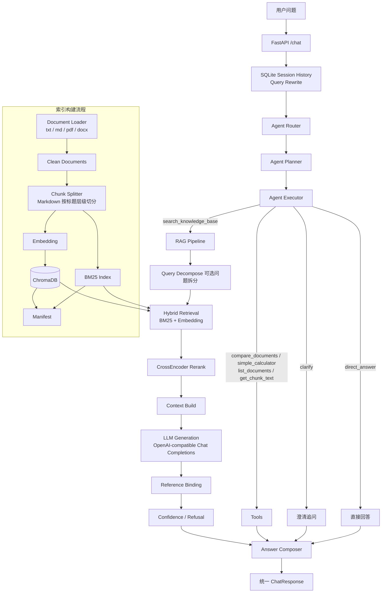

# Agentic RAG 知识库问答系统

一个面向中文制度类文档的 Agentic RAG 问答系统，支持文档解析、混合检索、重排、引用生成、Agent 路由、多轮追问改写、可观测性和离线评测。

本项目基于 FastAPI 构建，围绕中文知识库问答场景实现了一条完整的 RAG 工程链路：读取本地 `.txt` / `.md` / `.pdf` / `.docx` 文档，按文档结构切分 chunk，构建 BM25 + SentenceTransformer Embedding 混合检索索引，使用 CrossEncoder reranker 重排候选证据，再通过 OpenAI-compatible Chat Completions 模型生成带引用的答案。`/chat` 入口支持 legacy 与 LangGraph 两种 Agent Runtime，二者都复用 Router、Planner、Executor 和 Answer Composer 串联知识库问答、工具调用、直接回答和澄清追问；传入 `session_id` 时，还会结合 SQLite 中最近的会话历史对短追问做 Query Rewrite。

## 项目亮点

- 中文知识库问答：面向中文制度、校务、规范类文档，支持本地文档解析、检索、回答和引用溯源。
- 混合检索：BM25 负责关键词精确匹配，SentenceTransformer Embedding 负责语义召回，提升中文问答召回稳定性。
- CrossEncoder rerank：对候选 chunk 做二阶段重排，缓解初召回排序不准的问题。
- ChromaDB 持久化：chunk 文本、metadata 和 embedding 持久化保存，服务重启可复用索引缓存。
- LLM Router + 规则 fallback：可开启 LLM 路由，输出异常或参数非法时自动回退到规则路由。
- 可切换 Agent Runtime：默认保留 legacy 编排；LangGraph 主图的知识库路径使用独立 RAG 子图，两条路径共享返回协议和底层算法。
- 多轮追问改写：同一 `session_id` 下通过 SQLite 保留最近会话历史，短追问和指代问题会先改写成独立检索问题。
- 工具调用：支持知识库检索、双文档内容对比、简单四则运算、列出知识库文档和查看指定 chunk 原文。
- 引用绑定和拒答机制：模型输出的 `Reference N` 会绑定回真实文件与 chunk；证据不足或引用支撑不足时拒答。
- 可观测性：每次 `/chat` 请求记录 `trace_id`、阶段耗时、状态、工具调用、引用数量和 LLM 调用次数。
- bad case 日志：对模型格式异常、引用异常、工具异常、索引未就绪等失败样例做结构化记录。
- 离线评测闭环：支持批量生成预测结果，并从答案质量、检索命中、行为约束和可选 LLM Judge 语义判断等维度评测。

## 系统架构



## 核心能力

| 模块 | 已实现能力 |
| --- | --- |
| 文档读取 | 支持 `.txt`、`.md`、`.pdf`、`.docx`；文本类文件自动识别编码，PDF/DOCX 提取可检索文本 |
| 文档切分 | 普通文本按段落和标点递归切分；Markdown 按标题层级切分并保留标题路径 |
| 混合检索 | jieba + BM25 关键词召回，SentenceTransformer Embedding 语义召回 |
| 重排 | CrossEncoder reranker 对候选 chunk 重新排序 |
| 问题拆分 | 可选 Query Decompose，复杂问题可拆成子问题后多路召回并合并证据 |
| 多轮追问 | `session_id` 通过 SQLite 维持最近会话历史，对短追问、指代问题做 Query Rewrite |
| 答案生成 | 调用 OpenAI-compatible Chat Completions，要求模型返回 JSON |
| 引用绑定 | 将 `Reference N` 映射回真实文件、`chunk_id`、`snippet` 和分数 |
| Agent Runtime | Router 决策经 Planner 转为计划，由 Executor 执行，再由 Answer Composer 统一合成回答 |
| Agent 路由 | 支持规则路由和可选 LLM Router，失败时回退规则路由 |
| 工具调用 | `search_knowledge_base`、`compare_documents`、`simple_calculator`、`list_documents`、`get_chunk_text` |
| 可观测性 | `trace_id`、请求耗时、阶段耗时、工具调用日志、metrics 汇总接口 |
| 失败分析 | `logs/bad_cases.jsonl` 记录值得分析的失败样例 |
| 评测 | 支持规则评测、Chroma/chunks 索引取证和可选 LLM Judge 语义评估 |
| 索引缓存 | ChromaDB 持久化 chunk、metadata、embedding，manifest 记录索引构建状态 |

## RAG 流程说明

1. 文档加载：从 `RAG_FILE_PATH` 读取 `.txt` / `.md` / `.pdf` / `.docx` 文档。
2. 文本清洗：统一清理不可见字符、空白和文档噪声。
3. 文档切分：Markdown 先按标题层级切分并保留标题路径，普通文本按段落和标点递归切分。
4. 建立索引：构建 BM25 关键词索引，并使用 SentenceTransformer 生成 embedding；向量、chunk 和 metadata 持久化到 ChromaDB。
5. 多轮改写：`/chat` 如果传入 `session_id`，会读取最近历史；短追问或指代问题会先改写成独立问题。
6. Agent 执行：改写后的问题进入 Router；Planner 将路由决策转换为标准计划，Executor 执行 RAG、普通工具、澄清或直接回答步骤，最后由 Answer Composer 统一合成结果。
7. 查询拆分：启用 `ENABLE_QUERY_DECOMPOSE` 后，复杂问题可由拆分模型生成子问题。
8. 混合召回：查询时同时执行 BM25 和 embedding 召回，合并候选 chunk。
9. 二阶段重排：使用 CrossEncoder reranker 对候选证据重新排序。
10. 构造上下文：按 `MAX_CONTEXT_CHARS` 控制上下文长度，组装带 `Reference N` 的 evidence context。
11. LLM 生成：调用 OpenAI-compatible Chat Completions，要求返回结构化 JSON。
12. 引用绑定：解析模型返回的 references，并绑定到真实文件、chunk、snippet、score。
13. 置信度与拒答：结合召回分数、引用数量和证据阈值估算置信度；证据不足、检索为空或引用支撑不足时返回拒答状态。

## 评测结果

| Metric              |  Score |
| ------------------- | -----: |
| Evaluation Cases    |     65 |
| Final Score         | 0.9605 |
| Key Point Recall    | 0.9353 |
| Gold Chunk Hit@K    | 0.9846 |
| Gold Chunk Recall@K | 0.9756 |
| Gold Document Hit@K | 0.9846 |
| Behavior Score      | 0.9846 |
| Forbidden Hit       |      0 |

评测集覆盖 `single_doc`、`cross_doc`、`partial_answer`、`not_in_doc`、`trap` 五类问题。系统在普通单文档问答、跨文档问答和无答案拒答场景中表现稳定；当前主要优化方向是 `partial_answer` 场景和新旧政策冲突类 `trap` 问题。

## 工程化设计

- 配置通过 `.env` 管理，`.env.example` 提供默认模板，回答模型、路由模型、追问改写模型、拆分模型和评测 Judge 均使用 OpenAI-compatible Chat Completions 配置。
- 最终回答模型支持 `langchain` 和 `legacy` 两种客户端：默认由 `ChatOpenAI(base_url=...)` 调用 OpenAI-compatible 服务，兼容性有问题时可将 `LLM_CLIENT_MODE` 切换为 `legacy`，原有模型环境变量仍然有效。
- 支持 embedding / rerank 模型本地缓存，默认缓存目录为 `./.cache/huggingface/hub`，也可通过 `MODEL_CACHE_DIR`、`HF_HOME` 等环境变量调整。
- 支持 ChromaDB 持久化，默认将向量、chunk 文本、metadata 和文档注册信息保存到 `data/chroma/`。
- 启动时基于 manifest 判断是否需要重建索引；知识库文件、chunk 参数、embedding/rerank 模型或 pipeline 版本变化会触发重建。
- 多轮会话历史保存在 `SQLITE_DB_PATH` 指定的 SQLite 数据库中，每个 `session_id` 默认读取最近 6 条 user/assistant 消息，服务重启后仍可继续使用。
- 设置 `ENABLE_AGENT_TRACE_STORE=true` 后，Agent v2 的运行摘要和步骤明细会写入同一 SQLite 数据库的 `agent_runs`、`agent_steps` 表。
- `/chat` 请求支持继承或生成 `trace_id`，响应头返回 `X-Trace-Id` 和 `X-Total-Cost-Ms`。
- metrics 记录 Query Rewrite、路由、知识库就绪检查、检索、问题拆分、重排、上下文构造、LLM 调用、JSON 解析等阶段耗时和 LLM 调用次数。
- bad case 日志用于定位失败样例，包括模型 JSON 解析失败、引用异常、工具异常、内部异常和索引未就绪。

模型客户端统一和 LangGraph 编排彼此独立；切换 Runtime 不改变 RAG 检索、Rerank、ChromaDB 数据结构和引用机制。

## Chat 应用服务层

`/chat` 控制器现在只负责读取 HTTP 请求上下文、调用 `ChatService`、设置状态码，并使用现有 Response Builder 构造响应。Query Rewrite、Router、RAG Ready Check、Runtime 调用、metrics 和 session 存储由 `app/services/chat_service.py` 统一编排，因此聊天业务可以脱离 FastAPI 进行单元测试。

API 请求与响应 Schema、HTTP 状态语义和 trace 响应头保持不变；`legacy` 与 `langgraph` 仍通过 `AGENT_RUNTIME` 切换。本次重构没有修改 Agent Graph、RAG Subgraph 或旧 `rag.ask()` 的业务行为。

## LangChain Tool 适配层

现有 `ToolRegistry` 中的工具可以通过 `get_langchain_tools()` 按注册顺序转换为 LangChain `StructuredTool`。适配后的工具继续复用原有工具名称、Pydantic 参数 Schema 和返回协议，调用仍统一经过 `dispatch_tool()`，因此原有日志、耗时统计和请求级 `trace_id` 传递保持不变。

两种 Agent Runtime 都仍沿用 Executor → `dispatch_tool()` → `ToolRegistry` 的调用链；LangGraph 主图当前不会使用这组 `StructuredTool`，也尚未进行模型 `bind_tools()`。

## Agent Runtime 切换

当前支持 `legacy` 和 `langgraph` 两种运行时，默认继续使用 `legacy`。在 `.env` 中设置：

```env
AGENT_RUNTIME=legacy
```

或：

```env
AGENT_RUNTIME=langgraph
```

LangGraph Runtime 按 `route/initialize → plan → execute` 组织主图。成功的 `search_knowledge_base` observation 会进入 RAG 子图并直接到 `finalize`；普通工具、澄清、直接回答和工具错误仍进入原有 `compose → finalize`，因此知识库路径不会再次调用旧 `rag.ask()`。

### LangGraph RAG 子图

`AGENT_RUNTIME=langgraph` 时，知识库问答由独立子图依次执行问题歧义判断、Query Decompose、检索与重排、Evidence Gate、Context Build、回答生成、JSON 解析、引用绑定与验证。子图复用现有检索、Rerank、ChromaDB、模型网关、引用和置信度算法，API Schema 没有变化。

`AGENT_RUNTIME=legacy` 仍沿用 `run_agent_v2 → compose_rag_answer → rag.ask()`，旧顺序编排和评测入口继续保留用于回归对比。当前两条 Runtime 都未启用 ToolNode、`bind_tools()`、Checkpointer、Streaming 或 Interrupt，会话存储也未迁移。

## 快速启动

建议使用 Python 3.10+。

```bash
python -m venv .venv
source .venv/bin/activate
pip install -r requirements.txt
cp .env.example .env
```

Windows PowerShell 可使用：

```powershell
python -m venv .venv
.\.venv\Scripts\activate
pip install -r requirements.txt
copy .env.example .env
```

将知识库文档放到 `data/kb/`，然后编辑 `.env` 中的模型配置。启动服务：

```bash
uvicorn app.main:app --reload
```

启动后访问：

```text
Swagger: http://127.0.0.1:8000/docs
Health:  http://127.0.0.1:8000/health
```

首次启动可能会下载 embedding / rerank 模型权重并构建索引；后续如果知识库文件和索引参数没有变化，会复用本地 ChromaDB 和 manifest 缓存。

## Demo 页面

项目提供了一个 Streamlit Demo 页面，用于通过浏览器体验问答、检索和路由调试。先启动 FastAPI 后端：

```bash
uvicorn app.main:app --reload
```

再启动 Demo 页面：

```bash
streamlit run demo/streamlit_app.py
```

页面默认连接 `http://127.0.0.1:8000`，也可以在侧边栏修改后端地址。

## 环境变量

常用配置如下，完整示例见 `.env.example`。

| 配置项 | 说明 |
| --- | --- |
| `RAG_FILE_PATH` | 知识库目录，示例：`./data/kb` |
| `INDEX_STORE_DIR` | 索引构建 manifest 目录，示例：`./data/manifest` |
| `CHROMA_PERSIST_DIR` | ChromaDB 本地持久化目录，示例：`./data/chroma` |
| `CHROMA_COLLECTION_NAME` | ChromaDB collection 名称，默认 `mini_rag_chunks` |
| `TOP_K` | `/chat` 和 `/search` 默认召回条数 |
| `DECOMPOSE_TOP_K` | 多子问题召回合并后的候选上限 |
| `CHUNK_SIZE` | chunk 最大长度 |
| `CHUNK_OVERLAP` | 相邻 chunk 重叠长度 |
| `EMBEDDING_MODEL_NAME` | SentenceTransformer embedding 模型 |
| `RERANK_MODEL_NAME` | CrossEncoder rerank 模型 |
| `MODEL_CACHE_DIR` | embedding/rerank 模型权重本地缓存目录 |
| `MAX_CONTEXT_CHARS` | 拼给回答模型的最大上下文长度 |
| `LLM_CLIENT_MODE` | 最终回答模型客户端，支持 `langchain`（默认）或 `legacy` |
| `LLM_API_KEY` | 回答模型 API Key；兼容旧变量 `DEEPSEEK_API_KEY` |
| `MODEL_NAME` | 回答模型名称 |
| `LLM_API_URL` | OpenAI-compatible Chat Completions 地址 |
| `TEMPERATURE` | 回答模型温度 |
| `LLM_MAX_TOKENS` | 回答模型最大输出 token |
| `LLM_TIMEOUT` | 单次回答模型请求超时秒数 |
| `LLM_MAX_RETRIES` | 回答模型失败重试次数 |
| `LLM_RETRY_SLEEP` | 回答模型失败重试间隔秒数 |
| `USE_LLM_JUDGE` | 评测脚本是否启用 LLM Judge，默认 `false` |
| `JUDGE_API_KEY` | 评测 Judge 模型 API Key；为空时可复用回答模型 Key |
| `JUDGE_MODEL` | 评测 Judge 模型名称 |
| `JUDGE_API_URL` | 评测 Judge 模型接口地址 |
| `JUDGE_TIMEOUT` | Judge 模型请求超时秒数 |
| `JUDGE_MAX_RETRIES` | Judge 模型失败重试次数 |
| `JUDGE_MAX_TOKENS` | Judge 模型最大输出 token |
| `ENABLE_LLM_ROUTER` | 是否启用 LLM Agent 路由，默认 `false` |
| `ROUTER_API_KEY` | 路由模型 API Key；为空时复用回答模型 Key |
| `ROUTER_MODEL_NAME` | 路由模型名称 |
| `ROUTER_API_URL` | 路由模型接口地址 |
| `ROUTER_TIMEOUT` | 路由模型请求超时秒数 |
| `ROUTER_MAX_RETRIES` | 路由模型失败重试次数 |
| `ROUTER_MAX_TOKENS` | 路由模型最大输出 token |
| `ROUTER_TEMPERATURE` | 路由模型温度 |
| `AGENT_RUNTIME` | Agent Runtime，支持 `legacy`（默认）或 `langgraph` |
| `AGENT_MAX_STEPS` | Agent v2 单次请求最多执行的计划步骤数，默认 `5` |
| `ENABLE_AGENT_TRACE_STORE` | 是否将 Agent v2 运行摘要和步骤写入 SQLite，默认 `false` |
| `SQLITE_DB_PATH` | 会话历史及可选 Agent trace 的 SQLite 文件路径，默认 `./data/app.sqlite` |
| `ENABLE_QUERY_REWRITE` | 是否启用多轮追问改写，默认 `true` |
| `QUERY_REWRITE_API_KEY` | 追问改写模型 API Key；为空时复用回答模型 Key |
| `QUERY_REWRITE_MODEL_NAME` | 追问改写模型名称 |
| `QUERY_REWRITE_API_URL` | 追问改写模型接口地址 |
| `QUERY_REWRITE_TIMEOUT` | 追问改写模型请求超时秒数 |
| `QUERY_REWRITE_MAX_TOKENS` | 追问改写模型最大输出 token |
| `QUERY_REWRITE_TEMPERATURE` | 追问改写模型温度 |
| `ENABLE_QUERY_DECOMPOSE` | 是否启用问题拆分，默认 `true` |
| `DECOMPOSE_API_KEY` | 问题拆分模型 API Key |
| `DECOMPOSE_MODEL_NAME` | 问题拆分模型名称 |
| `DECOMPOSE_API_URL` | 问题拆分模型接口地址 |
| `DECOMPOSE_TIMEOUT` | 问题拆分模型请求超时秒数 |
| `DECOMPOSE_MAX_TOKENS` | 问题拆分模型最大输出 token |
| `VECTOR_THRESHOLD` | 召回证据不足时拒答的向量分数阈值 |
| `AUTO_REBUILD_ON_STARTUP` | 是否启动时强制重建索引 |

### DeepSeek 示例

```env
RAG_FILE_PATH=./data/kb
INDEX_STORE_DIR=./data/manifest
CHROMA_PERSIST_DIR=./data/chroma
CHROMA_COLLECTION_NAME=mini_rag_chunks

TOP_K=5
DECOMPOSE_TOP_K=10
CHUNK_SIZE=600
CHUNK_OVERLAP=120

EMBEDDING_MODEL_NAME=Qwen/Qwen3-Embedding-0.6B
RERANK_MODEL_NAME=BAAI/bge-reranker-v2-m3
MODEL_CACHE_DIR=./.cache/huggingface/hub
MAX_CONTEXT_CHARS=4000

LLM_CLIENT_MODE=langchain
LLM_API_KEY=your-api-key
MODEL_NAME=deepseek-chat
LLM_API_URL=https://api.deepseek.com/v1/chat/completions
TEMPERATURE=0.1
LLM_MAX_TOKENS=1024
LLM_TIMEOUT=60
LLM_MAX_RETRIES=2
LLM_RETRY_SLEEP=1

ENABLE_LLM_ROUTER=false
ROUTER_API_KEY=
ROUTER_MODEL_NAME=deepseek-chat
ROUTER_API_URL=https://api.deepseek.com/v1/chat/completions
ROUTER_TIMEOUT=10

AGENT_MAX_STEPS=5
ENABLE_AGENT_TRACE_STORE=false
SQLITE_DB_PATH=./data/app.sqlite

ENABLE_QUERY_REWRITE=true
QUERY_REWRITE_API_KEY=
QUERY_REWRITE_MODEL_NAME=deepseek-chat
QUERY_REWRITE_API_URL=https://api.deepseek.com/v1/chat/completions
QUERY_REWRITE_MAX_TOKENS=256

ENABLE_QUERY_DECOMPOSE=true
DECOMPOSE_API_KEY=your-api-key
DECOMPOSE_MODEL_NAME=qwen-plus
DECOMPOSE_API_URL=https://dashscope.aliyuncs.com/compatible-mode/v1/chat/completions
DECOMPOSE_MAX_TOKENS=512

USE_LLM_JUDGE=false
VECTOR_THRESHOLD=0.1
```

### Ollama 示例

```env
LLM_CLIENT_MODE=langchain
LLM_API_KEY=ollama
MODEL_NAME=qwen2.5:7b
LLM_API_URL=http://127.0.0.1:11434/v1/chat/completions

QUERY_REWRITE_API_KEY=ollama
QUERY_REWRITE_MODEL_NAME=qwen2.5:7b
QUERY_REWRITE_API_URL=http://127.0.0.1:11434/v1/chat/completions

DECOMPOSE_API_KEY=ollama
DECOMPOSE_MODEL_NAME=qwen2.5:7b
DECOMPOSE_API_URL=http://127.0.0.1:11434/v1/chat/completions
```

## API 示例

| 接口 | 方法 | 作用 |
| --- | --- | --- |
| `/health` | GET | 健康检查 |
| `/docs-preview` | GET | 查看已加载文档列表 |
| `/chunks-preview` | GET | 查看 chunk 预览，支持 `max_len`、`limit`、`file_name` |
| `/chat` | POST | 完整 Agent + RAG 问答入口 |
| `/search` | POST | 只执行检索和 rerank，不调用回答模型 |
| `/decide` | POST | 只返回 Agent 路由决策，不执行工具或 RAG |
| `/kb_summary` | POST | 返回知识库 ready 状态、文档数、chunk 数和 `index_source` |
| `/metrics-summary` | GET | 汇总最近 N 条 `/chat` 请求指标 |

### `/chat` 请求示例

```bash
curl -X POST "http://127.0.0.1:8000/chat" \
  -H "Content-Type: application/json" \
  -H "X-Trace-Id: demo-trace-001" \
  -d '{
    "question": "普通本科四年制专业学生现在最长学习年限是不是 8 年？",
    "top_k": 5,
    "decompose_top_k": 10,
    "session_id": "demo_session_001"
  }'
```

核心响应字段：

| 字段 | 说明 |
| --- | --- |
| `trace_id` | 本次请求追踪 ID，也会写入响应头 `X-Trace-Id` |
| `data.question` | 原始用户问题；如果触发 Query Rewrite，改写后的问题可在 `tool_trace` 中查看 |
| `data.answer` | 最终回答 |
| `data.references` | 引用来源列表，包含 `file_name`、`source_path`、`chunk_id`、`snippet`、`score`、`rerank_score` |
| `data.retrieval_confidence` | 0 到 1 的检索证据置信度估计 |
| `data.answer_confidence` | 0 到 1 的最终回答置信度估计 |
| `data.status` | `ok`、`no_evidence`、`empty_index`、`error`、`clarify`、`out_of_scope` |
| `data.need_clarification` | 是否需要用户补充问题 |
| `data.clarification_question` | 澄清追问 |
| `data.reason` | 当前状态原因 |
| `data.action` | Agent 选择的动作 |
| `data.tool_result_summary` | 工具或 RAG 路径摘要 |
| `data.tool_trace` | Query Rewrite、路由、工具调用、检索命中、最终状态等过程信息 |
| `data.router_llm_used` | 本次请求是否调用 Router LLM |
| `data.decompose_llm_used` | 本次请求是否调用问题拆分 LLM |
| `data.answer_llm_used` | 本次请求是否调用最终回答 LLM |
| `data.llm_call_count` | 本次请求累计 LLM 调用次数 |

### 多轮追问与 Query Rewrite

`/chat` 的 `session_id` 是可选字段。为空时系统按单轮问题处理；非空时系统会读取该会话最近 6 条 user/assistant 消息，并在问题像短追问或包含“这个、那个、它、上面、刚才”等指代词时尝试改写成独立问题。

改写逻辑的优先级是：先用规则判断是否需要改写；如果 `ENABLE_QUERY_REWRITE=true` 且改写模型配置可用，就调用改写模型；如果改写模型不可用或返回异常，会回退为“基于上一轮问题的追问”格式，保证主链路仍可继续。

### `/search`

`/search` 适合调试召回质量。它只执行检索和 rerank，不调用回答模型。

```json
{
  "question": "普通本科四年制专业学生现在最长学习年限是不是 8 年？",
  "top_k": 5
}
```

返回结果包含 `reference_id`、`file_name`、`source_path`、`chunk_id`、`position`、`snippet`、`score`、`bm25_score`、`vector_score`、`rerank_score`。

### `/decide`

`/decide` 用于观察 Agent Router 对问题的路由结果。

```json
{
  "question": "1 + 2 * 3 等于多少？",
  "top_k": 5
}
```

可能返回 `search_knowledge_base`、`compare_documents`、`simple_calculator`、`list_documents`、`get_chunk_text`、`clarify`、`direct_answer` 等动作。

### `/kb_summary`

返回当前知识库是否 ready、文档数量、chunk 数量、文件列表和 `index_source`。其中 `index_source=chroma` 表示当前索引来自 ChromaDB 缓存，`memory` 表示刚重建完成，`none` 表示没有可用索引。

### `/metrics-summary`

```text
GET /metrics-summary?limit=20
```

用于查看最近请求的状态分布、成功数、拒答数、错误数、平均延迟、平均 LLM 调用次数，以及 Router / Decompose / Answer LLM 的使用次数。

## Agent 路由与工具

当前支持的 action：

| action | 路径 |
| --- | --- |
| `search_knowledge_base` | 走 RAG 检索、重排、生成、引用绑定 |
| `compare_documents` | 按主题检索两个指定文档，返回双方证据并标记可能的差异或冲突 |
| `simple_calculator` | 调用安全四则运算工具 |
| `list_documents` | 返回当前知识库文档数量和列表 |
| `get_chunk_text` | 根据 `chunk_id` 返回完整 chunk 文本 |
| `direct_answer` | 由 Answer Composer 生成系统能力说明，不把 Router 的内部 reason 直接暴露为用户回答 |
| `clarify` | 问题过短、为空或指代不明时追问 |

如果 `/chat` 传入 `session_id`，Query Rewrite 会在 Agent Router 之前执行；Router 看到的是改写后的有效问题，响应中的 `data.question` 仍保留原始输入，改写细节记录在 `data.tool_trace` 的 `query_rewrite` step 中。

设置 `ENABLE_LLM_ROUTER=true` 后，系统会先调用路由模型生成 JSON 决策；如果模型调用失败、输出不是 JSON、action 非法或工具参数不合法，会自动回退到规则路由。

## 索引构建与缓存

服务启动时会检查当前知识库目录和构建参数：

```text
启动服务
  -> Settings.validate()
  -> 检查 manifest 和 ChromaDB 缓存
  -> 文档或配置变化：重建索引并保存缓存
  -> 无变化：从本地缓存加载索引
```

缓存分为两部分：

- `data/chroma/`：ChromaDB 向量库，保存 chunk 文本、chunk metadata、embedding 向量和文档注册信息。
- `data/manifest/index_manifest.json`：索引构建账本，用于判断知识库或索引参数是否变化。

以下变化会触发重建：新增/删除/修改知识库文件、修改 `CHUNK_SIZE`、修改 `CHUNK_OVERLAP`、修改 embedding 模型、修改 rerank 模型、pipeline 版本变化。修改 `TOP_K`、Prompt、回答模型名称、温度等通常不需要重建索引。

如需在启动 API 前先下载模型权重，可以运行：

```bash
python scripts/cache_models.py
```

## 日志与可观测性

`/chat` 会为每次请求生成或继承 `trace_id`：

- 请求头可传入 `X-Trace-Id`。
- 响应头会返回 `X-Trace-Id` 和 `X-Total-Cost-Ms`。
- 响应体也包含 `trace_id`。

日志文件：

| 文件 | 说明 |
| --- | --- |
| `logs/metrics.jsonl` | 每次 `/chat` 的耗时、状态、action、引用数、工具信息、Query Rewrite 和 LLM 调用统计 |
| `logs/tool_calls.jsonl` | 每次工具调用的输入、输出、耗时和是否成功 |
| `logs/bad_cases.jsonl` | 模型 JSON 解析失败、引用异常、工具异常、内部异常、索引未就绪等失败样例 |

日志汇总脚本：

```bash
python scripts/summarize_logs.py
```

默认读取 `logs/metrics.jsonl` 和 `logs/bad_cases.jsonl`，并将汇总结果写到 `outputs/week9_summary.md`。

## 测试与评测

运行测试：

```bash
pytest
```

生成 RAG 预测结果：

```bash
python scripts/predictions.py \
  --eval-file data/eval/rag_eval_questions_nmgut_graduate_v1.json \
  --out-file outputs/predictions.csv
```

评测预测结果：

```bash
python scripts/evaluate_rag_results_semantic_fixed.py \
  --eval-file data/eval/rag_eval_questions_v2_semantic_fixed.json \
  --pred-file outputs/predictions.csv \
  --out-dir outputs/rag_baseline1 \
  --k 10
```

评测脚本默认会优先从 ChromaDB 加载 chunk 文本和 metadata，用于计算文档命中、gold chunk 命中和证据匹配。需要语义级关键点评分时，可以通过参数或环境变量启用 LLM Judge：

```bash
python scripts/evaluate_rag_results_semantic_fixed.py \
  --eval-file data/eval/rag_eval_questions_v2_semantic_fixed.json \
  --pred-file outputs/predictions.csv \
  --out-dir outputs/rag_llm_judge \
  --k 10 \
  --use-llm-judge \
  --judge-model deepseek-chat
```

评测输出包括 `per_question_report.csv`、`summary_report.csv`、`summary_report.json` 和 `llm_judge_details.jsonl`。如果已经有上一轮 `per_question_report.csv`，可以用 `--judge-cache-report` 复用 Judge 结果，避免重复调用评测模型。

Agent 路由评测、压测和本地模型接口检查：

```bash
python scripts/agent_eval.py
python scripts/perf_test.py
python scripts/concurrent_perf_test.py
python scripts/test_local_llm.py
```

## 适合面试讲解的设计取舍

- 为什么不用纯向量检索，而是 BM25 + Embedding：中文制度文档里经常出现政策名、条款号、年份、专业名称等精确关键词，BM25 对这些字面匹配更敏感；Embedding 能补足语义相近但表述不同的问题，两者混合比单一路径更稳。
- 为什么引入 reranker：初召回阶段更关注“找全”，排序可能受关键词密度或向量相似度误差影响；CrossEncoder 可以基于 query-chunk 交互重新判断相关性，把更适合作答的证据排到前面。
- 为什么需要引用绑定：RAG 问答不能只给自然语言答案，还需要能追溯到文件、chunk 和片段，便于用户核验，也便于排查模型是否引用了错误证据。
- 为什么证据不足时拒答：制度类问答对准确性要求高，低相关度证据强行生成容易造成误导；系统通过阈值、引用绑定和模型输出检查，在证据不足时返回 `no_evidence`。
- 为什么 Agent Router 要有规则 fallback：LLM Router 能提升灵活性，但可能出现格式错误、动作非法或参数缺失；规则 fallback 保证核心路径可控，避免路由失败影响主流程。
- 为什么 Query Rewrite 只对追问触发：完整问题直接进入检索可以减少额外 LLM 成本；短追问和指代问题才结合历史改写，能在成本和多轮体验之间取得平衡。
- 为什么要做离线评测：RAG 优化不能只看单个 demo，需要用覆盖多场景的评测集持续观察召回、答案关键点、拒答行为和 forbidden 命中情况，形成可复现的优化闭环。

## 项目结构

```text
.
├── app/
│   ├── main.py                  # 正式 ASGI 入口：app.main:app
│   ├── api/
│   │   ├── chat.py              # FastAPI 组装和 /chat 主流程
│   │   ├── schemas.py           # 请求、响应和引用数据模型
│   │   ├── diagnostics.py       # 检索、知识库和指标诊断接口
│   │   ├── responses.py         # 响应构造和业务状态映射
│   │   └── lifecycle.py         # RAG 启动和索引加载流程
│   ├── agent/
│   │   ├── __init__.py          # Agent 公共入口
│   │   ├── router.py            # 路由决策与结果校验
│   │   ├── rules.py             # 数学、chunk 和文档对比规则
│   │   ├── llm_router.py        # LLM Router 调用与解析
│   │   ├── formatting.py        # 普通工具答案格式化
│   │   ├── state.py             # Agent 状态模型
│   │   ├── planner.py           # 执行计划构造
│   │   ├── executor.py          # 工具步骤执行
│   │   ├── answer.py            # 最终答案合成
│   │   └── runtime.py           # Agent 主流程编排
│   ├── graph/
│   │   ├── state.py             # LangGraph 状态 Schema
│   │   ├── nodes.py             # 复用现有 Agent 业务函数的节点
│   │   ├── conditions.py        # Router 条件入口
│   │   ├── builder.py           # StateGraph 构建、连接与缓存编译
│   │   └── runtime.py           # LangGraph 兼容 Runtime 门面
│   ├── rag/
│   │   ├── __init__.py          # RAG 公共门面和依赖注入
│   │   ├── pipeline.py          # 索引状态与问答流程编排
│   │   ├── graph/               # LangGraph RAG 子图状态、节点、条件、构建和运行入口
│   │   ├── ingest.py            # 文档读取、清洗、切分
│   │   ├── retrieval.py         # 混合召回与重排
│   │   ├── decomposition.py     # 复杂问题识别、拆分调用和解析
│   │   ├── policy.py            # 证据拒答与澄清策略
│   │   ├── scoring.py           # 分数安全转换
│   │   ├── results.py           # RAG 结果与门控 trace
│   │   ├── generation.py        # 模型调用、解析和引用绑定
│   │   ├── store.py             # 索引缓存、manifest、模型加载
│   │   ├── chroma.py            # ChromaDB 持久化
│   │   ├── citations.py         # 引用可靠性检查
│   │   └── debug.py             # 文档和 chunk 调试查询
│   ├── tools/
│   │   ├── __init__.py          # 工具公共入口
│   │   ├── result.py            # 统一成功/失败返回协议
│   │   ├── calculator.py        # 安全四则运算
│   │   ├── knowledge_base.py    # 文档、chunk 和检索工具
│   │   ├── compare_documents.py # 双文档证据对比
│   │   ├── dispatch.py          # 工具分发与调用日志
│   │   ├── langchain_tools.py   # LangChain StructuredTool 适配层
│   │   ├── registry.py          # 工具注册和分发
│   │   └── schemas.py           # 工具参数模型
│   ├── storage/                 # SQLite、session 和 Agent trace 存储
│   ├── observability/
│   │   ├── __init__.py          # trace_id 生成
│   │   ├── middleware.py        # HTTP trace 和端到端耗时
│   │   └── metrics.py           # 指标、bad case 和 trace 汇总
│   ├── common/logging.py        # 公共日志配置
│   ├── agent/query_rewrite.py   # 多轮追问识别和 Query Rewrite
│   ├── prompts.py               # RAG、问题拆分、路由 Prompt
│   └── config.py                # 环境变量配置
├── data/
│   ├── kb/                      # 默认知识库文档目录
│   ├── eval/                    # 评测数据
│   ├── chroma/                  # ChromaDB 持久化目录
│   └── manifest/                # 索引构建 manifest
├── scripts/
│   ├── predictions.py           # 批量生成 RAG 预测结果
│   ├── evaluate_rag_results_semantic_fixed.py
│   ├── rag_eval/                # 评测指标、Judge、检索打分和报告生成
│   ├── agent_eval.py            # Agent 路由评测
│   ├── summarize_logs.py        # metrics/bad_cases 日志汇总
│   ├── cache_models.py          # 预下载 embedding/rerank 模型
│   ├── perf_test.py             # 简单串行压测
│   ├── concurrent_perf_test.py  # 简单并发压测
│   └── test_local_llm.py        # 本地模型接口测试
├── demo/
│   └── streamlit_app.py         # Streamlit Demo 页面
├── tests/                       # 单元测试和接口测试
├── logs/                        # metrics、bad_cases、tool_calls
├── outputs/                     # 评测和日志汇总输出
├── .env.example
├── Dockerfile
├── docker-compose.yml
├── requirements.txt
└── README.md
```

> 说明：旧的根目录转发模块已经删除，项目统一使用上面的领域包路径。

## Docker

构建镜像：

```bash
docker build -t agent-rag-demo:latest .
```

推荐运行方式：

```bash
docker compose up -d
```

如果不用 compose，至少挂载知识库、索引和模型缓存目录：

```bash
docker run --rm -p 8000:8000 --env-file .env \
  -e RAG_FILE_PATH=/app/data/kb \
  -e INDEX_STORE_DIR=/app/data/manifest \
  -e CHROMA_PERSIST_DIR=/app/data/chroma \
  -e HF_HOME=/cache/huggingface \
  -e MODEL_CACHE_DIR=/cache/huggingface/hub \
  -e SENTENCE_TRANSFORMERS_HOME=/cache/sentence-transformers \
  -v "$(pwd)/data/kb:/app/data/kb:ro" \
  -v "$(pwd)/data/chroma:/app/data/chroma" \
  -v "$(pwd)/data/manifest:/app/data/manifest" \
  -v "$(pwd)/logs:/app/logs" \
  -v agent-rag-model-cache:/cache \
  --add-host=host.docker.internal:host-gateway \
  agent-rag-demo:latest
```

## 后续优化方向

- 优化 `partial_answer` 场景的 prompt，让模型在只能回答部分问题时更清晰地说明已回答和未覆盖部分。
- 强化新旧政策冲突判断，提升 `trap` 类问题中对时间、版本和政策优先级的识别能力。
- 继续优化 Query Rewrite 对跨轮限定、复杂指代和历史冲突的处理能力。
- 增加更完整的 CI，覆盖格式检查、单元测试、接口测试和关键评测脚本。
- 为 Streamlit Demo 增加更多调试视图，例如 Query Rewrite、Router 决策和检索命中对比。

## 已知限制

- 当前支持 `.txt`、`.md`、`.pdf`、`.docx`；PDF 依赖可提取文本，暂不内置 OCR，旧版 `.doc` 和图片文件暂不支持。
- 回答模型、路由模型、追问改写模型、拆分模型和 Judge 模型都按 OpenAI-compatible Chat Completions 格式调用。
- embedding 和 rerank 模型首次加载较慢，可能需要下载权重。
- 多轮历史使用本地 SQLite 持久化，适合单实例运行；多实例部署时需要额外规划共享存储和并发策略。
- legacy 与 LangGraph Runtime 都已具备标准 Planner / Executor 链路，但当前计划仍以单次工具调用加最终回答为主，不是可自主循环的复杂多工具 Agent。
- retrieval_confidence 和 answer_confidence 是启发式估计，不等同于严格概率。
