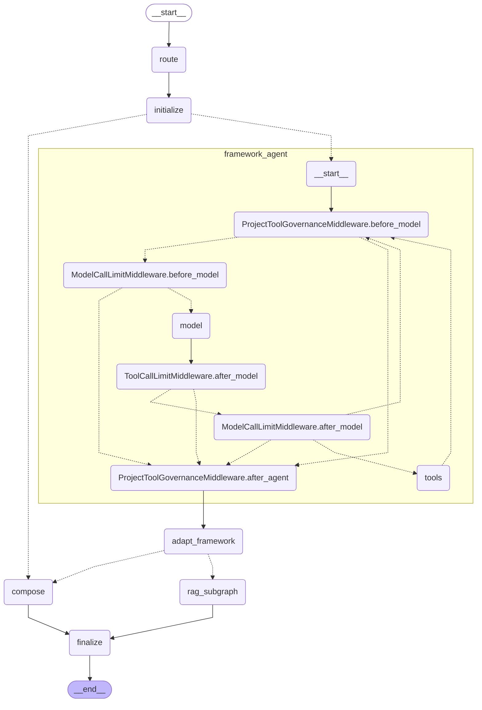

# Agent Runtime 维护指南

本文面向需要定位或维护 Agent Runtime、但不需要逐行阅读全部实现的开发者。当前唯一主实现是 LangGraph 父图嵌入 LangChain `create_agent` 子图；脚本输出是图结构和工具 Schema 的维护入口。

## 十分钟阅读路径

按以下顺序阅读，每个文件只关注表中内容：

| 顺序 | 文件 | 只需要理解 |
| --- | --- | --- |
| 1 | `app/services/chat_service.py` | 会话、请求改写、Runtime 和 API 结果收尾如何串联 |
| 2 | `app/contracts/chat.py` | Result status 如何唯一决定 HTTP、API 和 metrics 状态 |
| 3 | `app/graph/builder.py` | 父图固定入口、节点、边和条件出口 |
| 4 | `app/graph/state.py` | 唯一完整请求状态及 reducer |
| 5 | `app/agent/results.py` | AgentRunResult、内部/RAG 状态 mapper 和结果构造 |
| 6 | `app/graph/conditions.py` | 框架 Agent、RAG 与 compose 如何分流 |
| 7 | `app/graph/nodes.py` | `route_node` 如何独占 Router 调用/计时，以及节点如何返回显式更新 |
| 8 | `app/agent/framework_agent.py` | `create_agent`、调用限制 Middleware 和事件纯投影如何组装 |
| 9 | `app/agent/tool_events.py` | 标准工具结果和治理事件如何转换为 observation/trace |
| 10 | `app/agent/answer.py` | RAG 与 compose 如何生成无副作用状态更新 |
| 11 | `app/agent/framework_middleware.py` | 项目错误分类、预算、循环防护和同批 fail-closed |
| 12 | `app/agent/framework_tools.py` | 动态 StructuredTool、Registry dispatch 和 RAG handoff |
| 13 | `app/tools/runtime.py` | 单次工具调用的策略、审计、超时、重试和输出校验 |

## 主调用链

```text
FastAPI
→ ChatService
→ Session History / Query Rewrite
→ run_agent_langgraph
→ LangGraph Parent Graph: route → initialize
→ LangChain create_agent
→ RegistryToolsMiddleware / ProjectToolGovernanceMiddleware
→ StructuredTool
→ ToolRegistry.dispatch
→ ToolRuntime.execute
→ ToolSpec.handler
→ ToolMessage / Command.PARENT
→ RAG Subgraph 或 Compose
→ Finalize
```

ChatService 不调用 Router，也不生成或注入 decision。`route_node` 是生产代码中确定性 Router 的唯一所有者；正常 `/chat`、评测脚本和其他 `run_agent_langgraph()` 调用都会先经过它一次。Router 只决定 `agent`、`direct_answer` 或 `clarify`，具体工具始终由 `create_agent` 根据请求可见 Schema 选择。

`search_knowledge_base` 与普通工具一样由 Agent Model 根据动态 Schema 选择，并经过相同的 Registry/Runtime 治理链。成功结果通过 `Command.PARENT` 和 `pending_rag_result` 回到父图，再进入原 RAG 子图。不要把它移回 Router 或绕过 Runtime。

`web_search` 也是动态普通工具，但成功结果只形成 ToolMessage 并回到 Agent Model，不写 `pending_rag_result`。它通过 DDGS 查询公开互联网；本地受控证据仍必须使用 `search_knowledge_base`。

`web_fetch` 与 `web_search` 一样走普通 ToolMessage 路径：Agent 可先搜索，再从搜索结果选择一个公开 URL 抓取正文。HTML 正文通过 Trafilatura 提取；它不进入 RAG、不持久化网页，也不生成本地 references。

`web_pdf_fetch` 同样是普通 ToolMessage 路径，负责已知公开 PDF 的有限页范围。HTML 与 PDF 共用 `app/tools/web_download.py` 中的 requests-hardened 下载入口；PDF 使用已有 pypdf 提取带 `[Page N]` 边界的文本。它不进入本地 RAG、不持久化 PDF，也不生成本地 references。模型误用 `web_fetch` 读取 PDF 时，可根据内容类型错误 ToolMessage 在同一 `create_agent` 循环中改用 `web_pdf_fetch`，不需要 Router 或父图特判。

## 单一运行状态

`AgentGraphState` 是父图唯一的完整请求状态。节点不再取出嵌套业务对象后原地修改；initialize、框架事件投影、RAG 映射、compose 和 finalize 都返回明确的 LangGraph 字段 updates。

| 分组 | 字段 |
| --- | --- |
| 请求输入 | `original_question`、`effective_question`、`top_k`、`decompose_top_k`、`trace_id`、`session_id` |
| 路由 | `decision`、`route_cost_ms` |
| 框架治理 | `messages`、`governance_events`、`framework_events_applied`、迭代/工具/错误计数与指纹、`agent_elapsed_ms`、`stop_reason`、`pending_rag_result` |
| 业务结果 | `observations`、`final_answer`、`references`、`status`、`reason`、`decompose_llm_used`、`answer_llm_used`、`llm_call_count`、`tool_trace` |
| 最终输出 | `result` |

只有框架需要合并的 `messages` 和 append-only `governance_events` 使用 reducer。`observations`、`references` 和 `tool_trace` 由节点返回完整新列表，避免 checkpoint resume 或节点重放时重复追加；`llm_usage` 在 finalize 中执行 upsert。改写问题需要持久化到 trace 时，由 `effective_question != original_question` 派生，不在状态中重复保存。

## 单一结果契约与状态策略

父图内部状态、Runtime 结果和应用层响应是不同职责，固定转换链如下：

```text
AgentGraphState.status
→ map_agent_status_to_result_status
→ AgentRunResult
→ model_dump(mode="json")
→ ChatStatusPolicy
→ ChatServiceOutcome / API data.status / metrics status
```

RAG 子图协议不变；`map_rag_status_to_agent_status()` 先把 `OK`、
`NEED_CLARIFICATION`、`NO_RELEVANT_INFO`、`MODEL_ERROR` 和
`MODEL_BAD_OUTPUT` 收敛到内部 Agent 状态。`MODEL_BAD_OUTPUT` 在这里是 RAG 的真实
输入状态，但不是 Chat Result status。

`AgentRunResult` 是唯一完整 Runtime 结果模型，拒绝额外字段、非法状态、越界
confidence、负 LLM 计数以及非字典 references/tool trace。正常 finalize 和所有内部
错误结果都经过该模型。Pydantic 实例只用于边界校验，写入
`AgentGraphState.result`、Checkpoint 和返回 ChatService 的值均为普通字典。

`CHAT_STATUS_POLICIES` 是 HTTP status、code/message、公开小写状态、metrics
状态和错误字段暴露策略的唯一来源。未知 Result status 解析为
`INTERNAL_ERROR`，不会按成功处理。`EMPTY_QUESTION` 是服务级 400 兼容分支；
ChatService 调用 Runtime 本身抛出的未知异常继续保留公开
`code=MODEL_ERROR` 的历史兼容行为，但其完整 result 和 metrics 都按内部错误构造。

## 当前图

以下 Mermaid 由 `python scripts/inspect_agent_runtime.py --format mermaid` 的 `compiled_graph.get_graph(xray=True).draw_mermaid()` 输出生成。升级框架或修改图后应重新运行命令并替换本段，不要手工维护第二套图。



`RegistryToolsMiddleware` 使用 wrap hook 动态覆盖模型和工具请求，不会作为独立图节点出现；它是否仍正确提供工具由检查脚本的默认工具与 Schema 契约覆盖。

## 文件职责

| 文件 | 唯一主要职责 |
| --- | --- |
| `app/graph/builder.py` | 声明父图节点和边 |
| `app/graph/state.py` | 声明唯一完整 `AgentGraphState` 及 reducer |
| `app/graph/conditions.py` | 声明父图无副作用分支条件 |
| `app/graph/nodes.py` | 独占 Router 调用/计时；组合各节点的显式字段更新 |
| `app/contracts/chat.py` | 声明唯一 Result-to-HTTP/API/metrics 状态策略 |
| `app/agent/router.py` | 只产生 agent/direct_answer/clarify 的确定性决策 |
| `app/agent/results.py` | 校验完整 AgentRunResult；集中内部和 RAG 状态转换 |
| `app/agent/framework_agent.py` | 组装 `create_agent`；纯投影框架事件 |
| `app/agent/tool_events.py` | 将工具结果转换为 observation 和兼容 trace |
| `app/agent/answer.py` | 生成 RAG/compose 的 pure updates |
| `app/agent/framework_middleware.py` | 执行项目特有 Agent 治理 |
| `app/agent/framework_tools.py` | 适配动态工具；处理 RAG handoff |
| `app/tools/providers/local.py` | 按请求 `required_permissions` 过滤模型可见工具 |
| `app/tools/registry.py` | 注册 ToolSpec；统一分发工具 |
| `app/tools/runtime.py` | 治理并执行单次工具调用 |
| `app/tools/web_search.py` | 调用 DDGS；映射参数、规范化结果和转换公开异常 |
| `app/tools/web_download.py` | 为 HTML/PDF 提供共用 hardened 有限下载适配 |
| `app/tools/web_fetch.py` | 处理 HTML/XHTML/纯文本并调用 Trafilatura |
| `app/tools/web_pdf_fetch.py` | 校验 PDF magic；通过 pypdf 提取页范围和有限元数据 |
| `app/agent/runtime.py` | 构造兼容 decide/LLM trace；保存 trace |
| `app/services/chat_service.py` | 应用 ChatStatusPolicy；编排 metrics/session |
| `app/api/responses.py` | 规范化 confidence/LLM usage 并构造 API Schema |
| `app/observability/metrics.py` | 从 decide/tool/RAG trace 汇总稳定 metrics，不映射状态 |
| `app/rag/graph/` | 编排检索、证据、生成和引用流程 |

## 框架与项目边界

框架负责 `model ↔ tools` 循环、Pydantic 参数校验、基础 ToolMessage、`ModelCallLimitMiddleware` 和 `ToolCallLimitMiddleware`。项目 Middleware 只负责框架无法判断的 ToolErrorCode 语义、重复调用/错误、累计错误、总耗时和 terminal 同批 fail-closed。

工具执行的唯一受治理路径是：

```text
StructuredTool → ToolRegistry.dispatch → ToolRuntime.execute → ToolSpec.handler
```

Provider 的模型可见性层只复用 `has_permission()` 检查全部 `ToolSpec.required_permissions`，不运行完整 Policy。审批、幂等键、主体、来源和风险仍是执行期治理，因此权限满足的审批工具和写工具仍可见。项目 `ToolRuntime` 独占最终权限、策略、审批、审计、幂等、超时、有限重试和输出校验；可见性过滤和框架 Middleware 都不能替代或复制这些能力。

## 常见问题定位

| 问题 | 首先查看 |
| --- | --- |
| 状态字段在哪里定义 | `app/graph/state.py` |
| 内部状态为什么变成某个 Result status | `app/agent/results.py` |
| 某 Result status 的 HTTP/code/message 是什么 | `app/contracts/chat.py` |
| metrics 状态为什么这样记录 | `ChatStatusPolicy.metric_status` |
| API 字段如何构造 | `app/api/responses.py` |
| RAG 状态如何进入 Agent | `app/agent/results.py::map_rag_status_to_agent_status` |
| 工具事件如何进入状态 | `app/agent/framework_agent.py`、`app/agent/tool_events.py` |
| RAG 结果如何写回 | `app/agent/answer.py`、`rag_subgraph_node` |
| 最终结果如何构建 | `app/agent/results.py`、`finalize_node` |
| Checkpoint 保存什么 | `AgentGraphState` channels |
| Graph 为什么走这个分支 | `app/graph/builder.py`、`app/graph/conditions.py` |
| 请求为什么进入 direct/clarify/agent | `app/agent/router.py`、`app/graph/nodes.py::route_node` |
| Router 为什么执行两次 | 不应发生；检查调用方是否绕开 `run_agent_langgraph()` 或重复执行父图 |
| Router 耗时 | `decide` trace 的 `route_cost_ms`、`collect_trace_metrics()` |
| 模型为什么选择工具 | `app/agent/framework_tools.py`、ToolSpec description/Pydantic Schema 和 Agent Model |
| 工具为什么失败 | `app/tools/runtime.py`、Policy 和对应 ToolSpec handler |
| 模型为什么看不到某个工具 | `app/tools/providers/local.py`、`ToolSpec.required_permissions` |
| Web Search 为什么模型看不到 | `TOOL_DEFAULT_PERMISSIONS`、`app/tools/providers/local.py` |
| Web Search 为什么执行失败 | `app/tools/web_search.py`、`app/tools/runtime.py` |
| 搜索结果为什么为空 | DDGS region、`backend="auto"`、网络条件 |
| Web Search 为什么没有进入 RAG | 它是普通 Agent 工具；只有本地知识库检索进入 RAG |
| 如何更换搜索后端 | 保持 `app/tools/web_search.py` 的开源后端适配边界和 ToolSpec 契约 |
| 模型为什么看不到 `web_fetch` / `web_pdf_fetch` | `app/tools/providers/local.py`、`web:fetch` 权限 |
| 为什么 URL 被拒绝 | requests-hardened 配置和 `app/tools/web_download.py` 的 URL 业务规则 |
| 为什么没有正文 | Trafilatura 提取结果和页面实际可读正文 |
| 为什么页面过大 | `WEB_FETCH_MAX_RESPONSE_BYTES` |
| 为什么 `web_fetch` 拒绝 PDF | HTML 与 PDF 使用独立输出协议；PDF 应调用 `web_pdf_fetch` |
| 为什么 PDF 无文字 | 选定范围可能是扫描件/图片型 PDF；PR8 不支持 OCR |
| 为什么 PDF 被拒绝 | Content-Type/magic、加密、损坏、`WEB_PDF_MAX_RESPONSE_BYTES` 或 `WEB_PDF_MAX_DOCUMENT_PAGES` |
| 为什么 Web Fetch 没有 RAG references | `web_fetch` 是普通工具路径，不进入本地 RAG |
| 为什么 Web PDF 没有 RAG references | `web_pdf_fetch` 是普通工具路径，不写入本地知识库 |
| 工具可见但为什么执行被拒绝 | `app/tools/policy.py`、`app/tools/runtime.py` |
| 工具 trace 为什么这样生成 | `app/agent/tool_events.py` |
| ToolMessage 为什么异常 | `app/agent/framework_middleware.py`、`app/agent/framework_tools.py` |
| 模型失败为什么没有回退 | `app/agent/framework_middleware.py`、`adapt_framework_agent_node` |
| 知识库为什么进入 RAG | `Command.PARENT`、`rag_subgraph_node` |
| 知识库为什么没有引用 | `app/rag/graph/`、`app/rag/citations.py` |
| API 为什么返回某状态 | `app/contracts/chat.py`、`app/services/chat_service.py` |
| 图为什么创建 Checkpoint 文件 | `app/graph/checkpointing.py`、`app/graph/runtime.py` |
| 核心文件为何触发 CI | `scripts/inspect_agent_runtime.py` 的规模预算 |

## 新增普通工具

1. 定义 Pydantic Args Model。
2. 定义接收已校验参数和 `ToolInvocationContext` 的 handler。
3. 创建合法 `ToolSpec`，填写版本、描述、Schema 与治理元数据。
4. 注册到相应 `ToolRegistry`。
5. 增加工具行为、权限和错误结果测试。

正常情况下不需要修改 Router、Parent Graph、`create_agent` 或 Middleware。新增权限要求后应分别测试无权 Context 不可见、有权 Context 可见，以及直接 dispatch 的 Runtime 最终拒绝。模型可见 Schema 来自 StructuredTool/Pydantic，检查脚本不会维护第二份参数 Schema。

## 不应该做什么

- 不在 `nodes.py` 再实现工具循环。
- 不在 Router 硬编码普通工具意图。
- 不绕过 Registry 或 ToolRuntime 调用 handler。
- 不在 Provider 调用完整 Policy Engine 或复制权限字符串比较。
- 不重新手写框架已经生成的基础 ToolMessage。
- 不实现第二套参数 Schema。
- 不为框架已有能力创建自定义 Runtime。
- 不同时维护两套 Agent Loop。
- 不在父图状态中嵌套另一套完整业务状态。
- 不把 `AgentRunResult` 实例写入 Graph State 或 Checkpoint。
- 不在 Runtime、ChatService、API 或 metrics 中另建状态映射表。
- 不让 API Response Builder 导入 ChatService 或 Agent Runtime。
- 不在节点或 helper 中原地修改输入的 observations、references 或 tool_trace。
- 不从 `builder.py` 源码、AST 或正则反推图结构。

## 检查与升级

```bash
python scripts/inspect_agent_runtime.py
python scripts/inspect_agent_runtime.py --format json
python scripts/inspect_agent_runtime.py --format mermaid
python scripts/inspect_agent_runtime.py --check
```

脚本只使用普通 `build_agent_graph().compile()`，不会调用带 Checkpointer 的缓存入口；也不会初始化模型、DDGS、requests-hardened Manager、Trafilatura、PdfReader、执行 handler、访问网络或读取/重建 RAG 索引。报告验证 `AgentGraphState` 没有嵌套状态且包含全部业务字段，`AgentRunResult` 字段完整并拒绝 extra，所有 Result status 恰好有一项 policy，Graph result 仍是普通字典，API Response Builder 没有反向依赖，并且旧分散状态表没有残留。报告还分别列出 Registry 的八个 `registered_tools` 和默认 Context 的 `default_visible_tools`，验证默认可见集合、权限及 Web 工具契约。版本来自 `importlib.metadata`，图来自 `get_graph()`/`get_graph(xray=True)`，Mermaid 来自 `draw_mermaid()`，工具参数来自模型可见的 Pydantic JSON Schema。

升级 LangChain、LangGraph 或 Pydantic 时，先运行契约测试和 `--check`。重点确认父图节点未改变、xray 仍能展开 `framework_agent`、model/tools 和调用限制节点仍存在、`ToolRuntime` 注入字段未暴露给模型，并重新生成本页 Mermaid。
