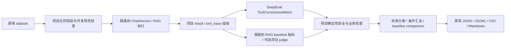

# FRAMEWORK-SLIM-4 — DeepEval Native Evaluation Core

> 历史记录：下文描述当时的审计或决策。当前已移除计算器与业务数据库只读工具，
> 工具集合以[当前系统架构](../architecture/current-system.md)为准。

## 修改前审计（先于实现）

- branch: `refactor/tool-output-models`
- HEAD: `725bc44c00e33c7287578c6169d28fe75ed4b1a1`
- worktree: clean
- Python 3.12.3；Pydantic 2.12.5；pytest 9.0.2。
- LangChain 1.3.14；langchain-core 1.4.9；langchain-openai 1.3.5；
  LangGraph 1.2.9；langchain-mcp-adapters 0.3.2。
- Python 物理行数（包括注释、空行）：`scripts/evaluation/**/*.py` 6502；
  `app/**/*.py` 20377。测试单独统计，不算 Evaluation 实现。

当前流程：dataset → contracts/schema validation → runner（隔离 Settings、
SQLite、metrics、audit、缓存和 MCP 生命周期）→ RAG predictions / ChatService
→ result/trace extraction → 自研工具判分 + 项目断言 + 可选 RAG judge
→ failure classification → aggregation → baseline comparison
→ JSON / JSONL / CSV / Markdown。

| 分类 | 当前代码与消费者 | 决策 |
| --- | --- | --- |
| A. PROJECT_SPECIFIC_KEEP | `contracts.py`；`data/eval/*.json`；runner、合同测试 | 保留 schema、版本、ID、suite、tags、disabled、expected status/action |
| A | `runner.py` 的 dirty guard、Settings/SQLite/metrics/audit 隔离、cache reset、MCP lifecycle；`agent.InMemorySessionAdapter`、`capture_tool_output_keys` | 保留运行和安全边界 |
| A | `manifest.py` 的 Git、配置、模型/提示词/数据/索引 hash、effective top-k；`comparison.py` | 保留可复现性、比较口径和阈值 |
| A | `agent.py` 的 decision/action/status、tool status、source/output keys、query rewrite、keyword/forbidden、origin/server、permission/approval/untrusted checks、失败分类 | 保留确定性项目断言，不转成 LLM metric |
| A | `external.py` 的 allowlist/preflight、safe catalog、secret scan；Agent artifact sanitization | 保留安全验收与信息脱敏 |
| B. FRAMEWORK_REPLACEABLE | `agent.score_agent_turn` 的 tools_contains、tool_sequence；汇总中的 sequence accuracy | 交给原生 `ToolCorrectnessMetric`；名称匹配，不提供 available_tools，不用 judge |
| B → A（保持现有语义） | first_tool / first_tool_any_of | 保留 OR 与空 trace 的历史语义；原生 metric 没有备选期望列表，额外封装不划算 |
| B → A（不等价） | `rag/judge.py` 四态关键点、partial 半分、contradiction、forbidden 的否定语义；`rag/evaluation.py` 消费各明细计算 Final Score | 原生 RAG metrics 不表达该合同，保留；不冒充同名指标 |
| A | `rag_predictions.py`、`rag/common.py`、`rag/retrieval.py` 的预测版本、final/context/reference funnel、gold chunk/document 对齐、严格/宽松召回 | 保留项目证据诊断；生产检索和 Evidence Gate 完全不动 |
| A | `agent.calculate_agent_metrics` 的条件分母、多轮合并、suite/origin/server 分组；`report.py`、`rag/report.py` | 保留 baseline 指标及外部格式，DeepEval 通用汇总不是同一口径 |
| C. COMPATIBILITY_ONLY | `rag_evaluator.py` 的 call_judge_llm/json、evaluate_key_points/forbidden_with_llm、evaluate 透传链；仅 `tests/test_evaluate_rag_judge.py` 依赖替换点 | 测试迁至实际所有者后删除；保留 run_rag_evaluation 编排 |
| C | `agent._expected_as_legacy` 把 ExpectedOutcome 转回旧 dict 再读回 | 消费者收敛到 ExpectedOutcome 后删除 |
| D. DEAD_OR_REDUNDANT | 上述透传链对应的 judge `call_judge_*_fn` 参数、兼容 re-export | 无其他消费者，随透传链删除；不留旧入口 |

报告消费者已经核对：`comparison.py` 读取 `baseline_summary.json` 和
`agent/per_case.jsonl`；`rag_evaluator.load_judge_cache_report` 读取
`per_question_report.csv`；`docs/evaluation/baseline-v2.md`、
`scripts/evaluation/README.md` 约定 JSON/CSV/Markdown 人工复盘流程。
本轮没有确认可删除的稳定 report field。

## 框架兼容性与迁移边界

官方 [PyPI 4.2.2](https://pypi.org/project/deepeval/4.2.2/) 是审计时最新稳定版，
但其 Python 3.12 依赖 PostHog >=7，与当前 Chroma 1.3.7 要求的 PostHog <6
冲突。安装探针的 `pip check` 确认冲突后，已恢复 PostHog 5.4.0。
检查 3.9.1–3.9.9、4.0.10、4.1.10、4.2.1 的 PyPI 依赖元数据，选择
[DeepEval 3.9.6](https://pypi.org/project/deepeval/3.9.6/) 固定到两个 requirements
文件；3.9.7 起的 PostHog 要求已不兼容。3.9.6 支持 Python 3.12，要求
Pydantic >=2.11.7,<3，当前环境最终 `pip check` 通过。
[Tool Correctness](https://deepeval.com/docs/metrics-tool-correctness) 可独立 measure；
下载 [3.9.6 源码](https://github.com/confident-ai/deepeval/blob/v3.9.6/deepeval/metrics/tool_correctness/tool_correctness.py)
确认：不提供 available_tools 时不进行 LLM 评分，但构造器仍会初始化
model。须使用拒绝生成的最小模型占位，避免默认 OpenAI client/API key 要求。

已实测：空期望代表“未声明约束”；first_tool_any_of 是 OR；contains
允许额外调用且重复期望不增加次数要求；sequence 是含重复项的完整有序列表。
不把整个 trace 或 MCP 正文传给框架，只转换名称。

[Faithfulness](https://deepeval.com/docs/metrics-faithfulness) 衡量答案相对 context
的事实支持；[Contextual Recall](https://deepeval.com/docs/metrics-contextual-recall)
衡量检索 context 对 expected output 的支持，均不等于本项目逐 gold key point
覆盖合同。Answer Relevancy、Contextual Precision/Relevancy 也不是当前 gold-ID
指标的等价替代。Argument Correctness 和这些新增 LLM 指标本轮均不启用。

只调用原生 metric.measure，并显式传 `_log_metric_to_confident=False`，
不用 evaluate/assert_test/Cloud/observe。
在导入前关闭 telemetry、tracing、dotenv autoload、版本检查和框架文件写入；
禁用 DeepEval 自动 pytest 插件，避免它早于项目配置导入并接管普通测试。
无第二套 LLM 配置；已有 RAG judge 继续使用项目 factory + ModelGateway。

## 最终结果：PASS_WITH_FINDINGS

DeepEval 实际接管工具包含匹配和完整序列匹配。项目只把提取后的工具名列表转换为
LLMTestCase.tools_called / expected_tools，不传 question、answer、arguments、
tool output、retrieval context 或原始 trace。未声明期望时保持原有不约束语义，
contains 期望去重，exact 保留重复次数及顺序；仍使用原有布尔字段与失败原因。
汇总中的 sequence accuracy 也调用同一原生评分，不保留另一份序列比较算法。



实际文件改动：

| 文件 | 改动 |
| --- | --- |
| `scripts/evaluation/deepeval_adapter.py` | 59 行本地原生评分与禁用 judge 的最小占位；关闭遥测、上传、自动 dotenv、版本检查、框架写入 |
| `scripts/evaluation/agent.py` | 用 DeepEval 替换包含/完整序列判分；删除 `_expected_as_legacy`；keyword/output-key 检查直接读取 ExpectedOutcome |
| `scripts/evaluation/rag_evaluator.py` | 删除五个兼容透传函数，直接调用 `rag.evaluation.evaluate`；保留缓存、编排和报告 |
| `scripts/evaluation/rag/judge.py` | 删除仅服务于上述透传链的三个 callback 参数和分派；保留模型网关、JSON 重试及判分语义 |
| `tests/test_agent_eval.py` | 原内部 helper 测试迁到 ExpectedOutcome |
| `tests/test_evaluate_rag_judge.py` | monkeypatch 实际 judge 所有者；补充 JSON 重试调用边界验证 |
| `tests/test_evaluation_agent.py` | 保持现有业务/安全回归覆盖，固定 any-of 空 trace 的历史行为 |
| `tests/test_evaluation_deepeval.py` | 原生评分边界、名称转换、无敏感正文、离线导入、无上传、pytest 插件关闭 |
| `tests/test_evaluation_smoke.py` | 3 个离线集成 case，复用实际 ChatService/工具执行边界和报告写入 |
| `requirements.txt` / `requirements.lock` | 固定 deepeval==3.9.6 |
| `pytest.ini` | `-p no:deepeval` 防止 Cloud pytest 插件抢先导入并接管测试运行 |
| `scripts/evaluation/README.md` / 本文 | 记录本地运行边界、审计、版本选择、验收证据 |

删除的定义：`agent._expected_as_legacy`；`rag_evaluator.call_judge_llm`、
`call_judge_json`、`evaluate_key_points_with_llm`、`evaluate_forbidden_with_llm`、
`evaluate`。`rag.judge` 中同名的实际实现保留。共删除 6 个函数，新增一个评分函数
和一个不能调用模型的占位类，净减少 4 个顶层定义。

按设计保留 dataset/version、manifest、Settings/session/MCP isolation、
output-schema capture、source/rewrite/status/action、权限和 approval、
handler_executed/untrusted 验证、secret scan、失败分类、baseline comparison、
报告字段与编码。没有改动 `data/eval/`、生产 Agent/RAG、检索排名、BM25/vector
融合、reranker、Evidence Gate 或阈值。

### LOC

| 指标 | 数值 |
| --- | ---: |
| evaluation_python_loc_before | 6502 |
| evaluation_python_loc_after | 6437 |
| evaluation_net_loc_change | -65 |
| production_app_loc_before | 20377 |
| production_app_loc_after | 20377 |
| production_app_net_change | 0 |

实现文件净删 124 行、新增 adapter 59 行；`agent.py` 本身只净减 9 行。
这是有限范围的替换，主要减量来自删除兼容透传链，不能宣称整个 Evaluation 引擎
或大段 RAG semantic evaluator 已被 DeepEval 替代。测试不计入上述实现 LOC。
本轮测试代码净增 203 行；若将实现与测试合计，净增 138 行。实现职责和透传定义
确有减少，但连同回归覆盖不能宣称总代码量下降。

### 依赖

最终新增 DeepEval 3.9.6 及 14 个传递依赖：nest-asyncio、pyfiglet、pytest-asyncio、
prompt_toolkit、execnet、sentry-sdk、pytest-rerunfailures、tabulate、portalocker、
pytest-xdist、questionary、wheel、pytest-repeat、wcwidth。
为满足框架约束，Click 8.4.2 → 8.3.3、Rich 15.0.0 → 14.3.4。
PostHog 最终恢复 5.4.0；Chroma、Pydantic、pytest、LangChain/Core/OpenAI、
LangGraph、MCP adapters 均保持修改前版本。没有新增直接声明的 LLM client。
Sentry/PostHog 是框架传递依赖，其初始化/遥测已通过导入前 opt-out 关闭；
不增加生产 instrumentation。

### 验证

所有 Python 命令使用 `.venv/bin/python`。没有调用真实 LLM、Judge、GitHub MCP
或 Firecrawl，没有重建/写入知识库索引。

- Gate A：最终 `pip check` 通过；9 个实际修改/新增 Python 文件 `ruff check`
  通过；4 个 Evaluation 模块 `compileall` 通过；`git diff --check` 通过。
- Gate B：4 个直接修改的 evaluation 测试文件首次运行 41 passed；补充的
  pytest 插件禁用、judge canonical JSON 重试两项测试 2 passed；共 43 项。
- Gate C：3 个 case。Direct 和 Local Tool 使用真实 ChatService、假 Agent 决策；
  Local Tool 实际执行 `simple_calculator`，验证 schema capture、判分与 JSONL/CSV。
  RAG 使用假 retrieval/subgraph、临时 chunks，实际走预测 CSV → RAG evaluator →
  四种报告产物；judge disabled。三项最终通过。
- RAG smoke 第一次因测试误用汇总字段名失败，修正为逐题字段
  `retrieval_gold_chunk_recall_at_k` 后只重跑该一项通过；未修改生产/评测行为。
- 临时等价性探针：128 组确定性输入，覆盖空/重复/额外/逆序调用、成功/失败状态、
  any-of、keyword/schema failure；新旧完整 row 逐字段相等，汇总 metrics 相等。
  旧 scorer 仅存 `/tmp` 用于该探针，不进入仓库或运行时。
- 新进程中拦截 socket.connect/connect_ex 并设置假 Cloud key，导入及评分零网络
  尝试；Cloud metric post 入口被替换成失败函数仍通过，临时目录未生成框架文件。
- MCP 没有新增独立 smoke；Gate B 继续覆盖 MCP permission/approval、信任标记、
  来源和外部错误分类，没有改 MCP adapter。

`total_tests_run`：46 个不同 pytest 测试通过；含修正前的一次 RAG smoke 失败，
实际执行 47 次。另有 128 组纯函数等价性探针，不计 pytest 数量。
RAG smoke 出现现有 jieba/pkg_resources 弃用警告，不影响测试结果。

```text
full_pytest_suite: NOT_RUN
full_agent_evaluation: NOT_RUN
full_rag_evaluation: NOT_RUN
online_mcp_evaluation: NOT_RUN
real_llm_judge: NOT_RUN
```

### 后续需要注意

1. 升级 DeepEval 不能只放宽版本号：最新版本 PostHog 与当前 Chroma 冲突，且
   本轮的 `_log_metric_to_confident=False` 依赖固定版本的实际 measure 签名。
2. 旧 `first_tool_any_of` 配合空 trace 时，`actual_tool == expected.first_tool == ""`
   使首工具检查通过。本轮保持兼容；修复必须作为独立 baseline 合同变更。
3. 原生 RAG semantic metrics 与现有四态/partial/forbidden 合同不同，不能直接
   替换同名报告字段。下一阶段应先决定指标与 baseline 版本，再迁移。

最终决策：真实替换一类通用工具评测能力，净减 65 行 Evaluation 实现，未形成
双 runtime；项目安全检查独立，生产行为无改动。可继续下一阶段，但本轮成果是
有限的工具判分迁移和兼容层清理。分支与 HEAD 保持不变；工作区有待审阅修改，
未 commit、push、切换分支或修改 main。
